# Proyecto de Patrones de Diseño de Software

Los patrones de diseño de software son soluciones reutilizables que permiten abordar problemas recurrentes durante el diseño y desarrollo de aplicaciones. No constituyen código listo para copiar y pegar, sino modelos de diseño que orientan la organización de las clases, la distribución de responsabilidades y la interacción entre los componentes de un sistema.

La aplicación adecuada de estos patrones contribuye a mejorar la mantenibilidad, la reutilización del código, la flexibilidad y la capacidad de evolución del software. Sin embargo, cada patrón debe seleccionarse de acuerdo con las necesidades del sistema, evitando introducir complejidad innecesaria.

Este proyecto tiene como propósito estudiar e implementar progresivamente diferentes patrones de diseño sobre **SmartGrid**, un sistema de gestión de redes eléctricas inteligentes. A través de estas implementaciones se busca comprender su funcionamiento, identificar los problemas que resuelven y evaluar cómo contribuyen a la estructura y organización de una aplicación.

## Organización del proyecto

El desarrollo se organiza por semanas. Cada directorio correspondiente a una semana contiene los avances y evidencias del trabajo realizado, permitiendo conservar un registro de la evolución del proyecto.

- **Proyecto principal:** `smartgrid/smartgrid`
- **Base de datos:** carpeta `Base de datos`
- **Documentación y evidencias:** directorios semanales y recursos incluidos en el repositorio.

Los patrones se incorporan de manera progresiva sobre el proyecto principal, procurando conservar las funcionalidades existentes y mantener una estructura organizada.

## SmartGrid

SmartGrid es un sistema de gestión de redes eléctricas inteligentes orientado a la administración de la infraestructura energética, la gestión del consumo y la integración de fuentes de energía renovable.

El proyecto se desarrolla progresivamente mediante la implementación de patrones de diseño que permiten organizar las responsabilidades del backend, reducir el acoplamiento entre componentes y facilitar el mantenimiento y la incorporación de nuevas funcionalidades.

La aplicación cuenta con un backend desarrollado con **Java y Spring Boot**, una base de datos **PostgreSQL** y una interfaz web desarrollada con **Angular**.

Las funcionalidades y los patrones implementados se documentan a lo largo de este README, incluyendo sus objetivos, las clases involucradas, los diagramas UML y las evidencias de funcionamiento disponibles.

> **Nota:** las instrucciones para descargar, configurar y ejecutar SmartGrid se encuentran al final de este documento.

### Objetivo general

Desarrollar progresivamente un sistema de gestión de redes eléctricas inteligentes que permita administrar información relacionada con el consumo energético, la infraestructura de generación, las fuentes de energía renovable y la facturación, utilizando patrones de diseño de software para mejorar la organización, mantenibilidad y extensibilidad de la aplicación.

### Objetivos específicos

- Diseñar mecanismos para consultar y visualizar información relacionada con el consumo energético.
- Establecer una estructura que permita incorporar funcionalidades de gestión de la demanda y balanceo de cargas.
- Modelar la infraestructura de generación eléctrica y facilitar la representación de fuentes renovables, como la solar y la eólica.
- Implementar mecanismos de facturación que permitan calcular los costos del consumo de acuerdo con las tarifas y los parámetros definidos.
- Desarrollar un panel web para consultar información y funcionalidades disponibles en el sistema.
- Aplicar y documentar patrones de diseño que favorezcan la separación de responsabilidades, la reutilización del código y la evolución de la arquitectura.
- Verificar las implementaciones mediante pruebas y solicitudes a los endpoints REST, documentando los resultados obtenidos.

## Patrones de diseño implementados

A lo largo del proyecto se incorporan patrones de diseño seleccionados de acuerdo con las necesidades de SmartGrid. Cada implementación incluye una descripción de su propósito, su aplicación dentro del sistema y los componentes principales que participan en ella.


## Patrón Singleton

### Propósito

El patrón creacional Singleton permite controlar la creación de instancias de una clase cuando se requiere un único objeto compartido para una responsabilidad determinada. Su objetivo es centralizar el acceso a ese objeto y evitar la creación de múltiples instancias independientes.

### Implementación en SmartGrid

En SmartGrid, este patrón se aplica a la clase `SmartGridConfig`, encargada de mantener la configuración general del sistema, como su nombre y su estado de activación.

La clase proporciona un punto de acceso a la configuración para que los componentes que la necesitan consulten o modifiquen sus valores de forma centralizada.

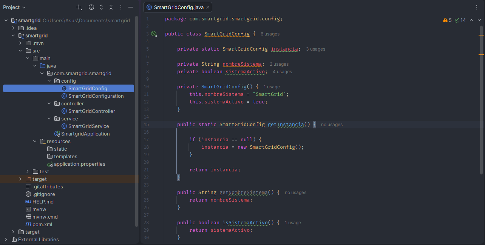

En la implementación del patrón se utiliza una instancia compartida, un constructor privado y el método `getInstancia()`, que permite obtener esa instancia sin crear objetos nuevos desde otras clases.

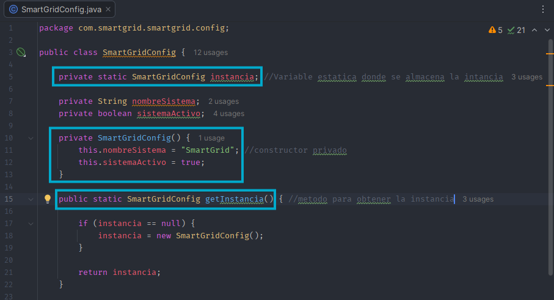

### Diagrama UML

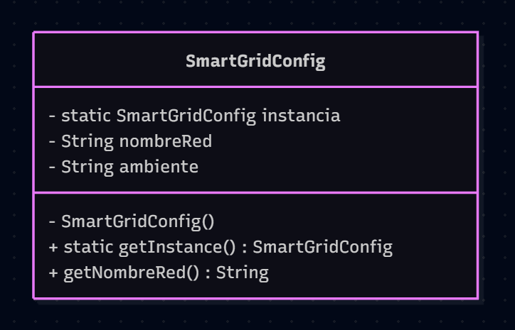

### Video Patrón Singleton

[](https://www.youtube.com/watch?v=1u5A9hnG09Y)

---

## Patrón Factory Method

### Propósito

El patrón creacional Factory Method define un método para crear objetos y delega a las implementaciones concretas la decisión de qué tipo de objeto instanciar. Esto permite separar la creación de los objetos de la lógica que los utiliza.

### Implementación en SmartGrid

En SmartGrid, Factory Method se utiliza en el módulo de facturación para generar facturas de diferentes categorías de clientes, como residenciales y comerciales.

La implementación se encuentra organizada en el paquete `com.smartgrid.smartgrid.factory` y se integra con las capas de servicio y controlador.

### Clases involucradas

- `Factura`: interfaz que define el contrato común para los diferentes tipos de factura.
- `FacturaResidencial` y `FacturaComercial`: productos concretos que implementan el comportamiento específico de cada categoría.
- `FacturaFactory`: creador abstracto que declara el método `crearFactura()`.
- `FacturaResidencialFactory` y `FacturaComercialFactory`: creadores concretos que deciden qué implementación de `Factura` instanciar.
- `FacturacionService`: utiliza la fábrica correspondiente para generar la factura y calcular el valor del consumo.
- `FacturacionController`: expone la funcionalidad mediante el endpoint REST `/api/facturacion`.

La interfaz `Factura` establece el contrato común del producto.

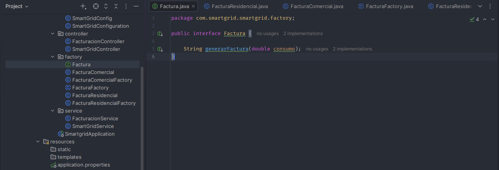

Las clases concretas implementan el comportamiento correspondiente a cada tipo de factura.

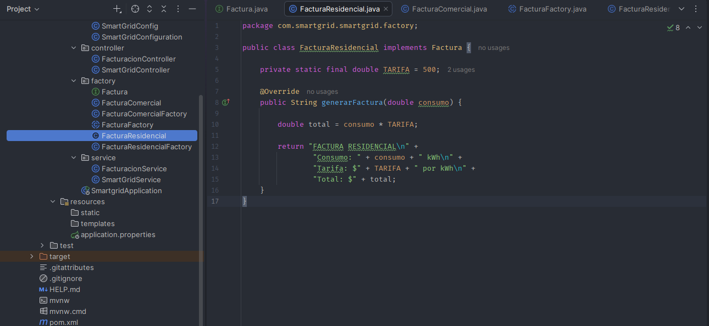

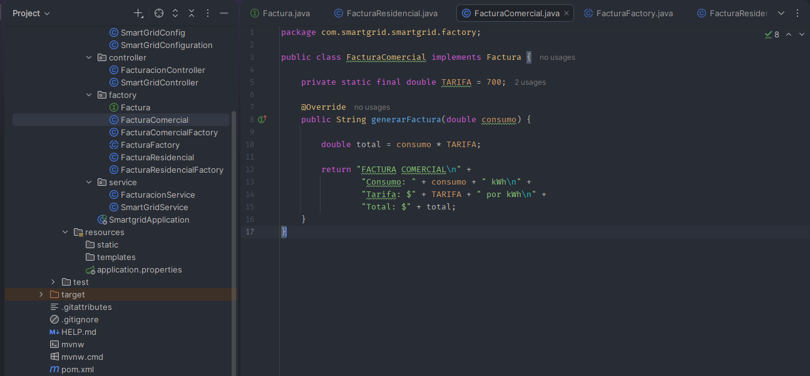

La clase abstracta `FacturaFactory` define el método de creación.

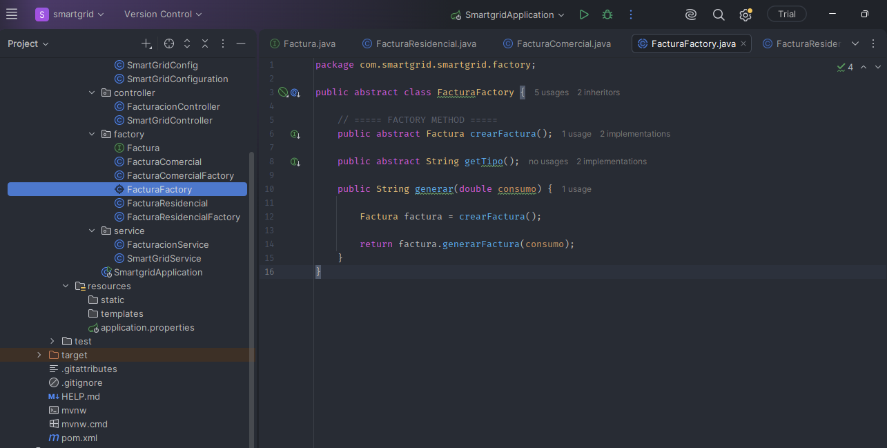

Las fábricas concretas implementan ese método y devuelven el producto correspondiente. De esta forma, `FacturacionService` puede trabajar con la abstracción sin tener que construir directamente cada tipo de factura.

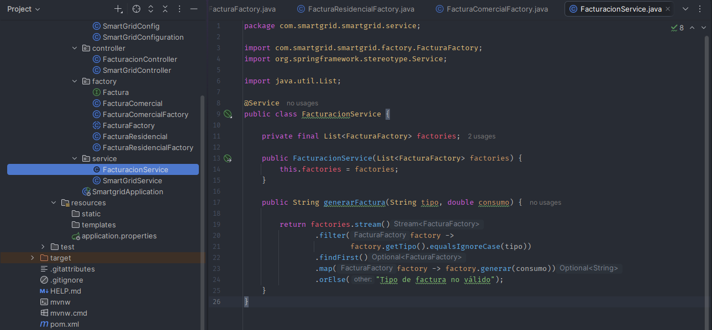

### Funcionamiento

1. El cliente envía una solicitud al endpoint `/api/facturacion`, indicando el tipo de factura y el consumo.
2. El controlador delega el procesamiento a `FacturacionService`.
3. El servicio utiliza la fábrica correspondiente.
4. La fábrica crea una implementación concreta de `Factura`.
5. Se calcula el importe y se devuelve la respuesta en formato JSON.

### Ventajas

La incorporación de un nuevo tipo de factura puede realizarse mediante una nueva implementación de `Factura` y su fábrica correspondiente, reduciendo la necesidad de modificar la lógica que utiliza los productos. La ampliación concreta dependerá de cómo se registre y seleccione la nueva fábrica.

### Diagrama UML

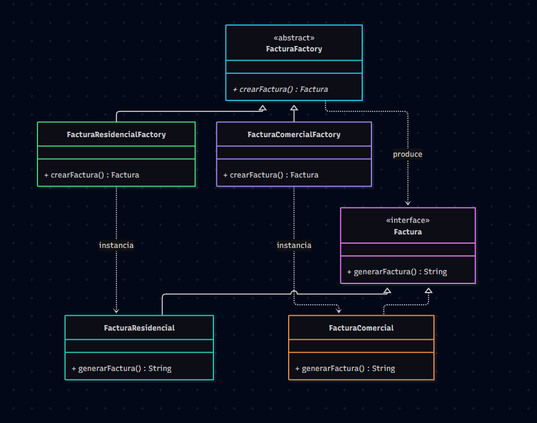

### Video patrón Factory Method

[](https://www.youtube.com/watch?v=Ty08ICiVTJ0)

---

## Patrón Builder

### Propósito

El patrón creacional Builder permite construir objetos complejos paso a paso, separando el proceso de construcción de la representación final del objeto. Es especialmente útil cuando una clase contiene atributos obligatorios y opcionales.

### Implementación en SmartGrid

En SmartGrid, Builder se utiliza para construir objetos `PlantaEnergia`. Este patrón permite especificar los datos obligatorios de una planta y configurar opcionalmente su capacidad, batería de reserva y ubicación.

La implementación se encuentra en la clase `PlantaEnergia.java`, que contiene la clase interna estática `PlantaEnergiaBuilder`.

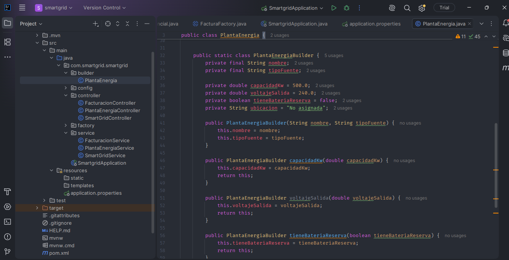

### Clases involucradas

- `PlantaEnergia`: representa la planta energética construida y contiene sus atributos.
- `PlantaEnergiaBuilder`: define los datos requeridos, los valores por defecto y los métodos encadenados para configurar las propiedades.
- `PlantaEnergiaService`: coordina la construcción a partir de los parámetros recibidos.
- `PlantaEnergiaController`: expone la operación mediante el endpoint REST `/api/planta/crear`.

El constructor del builder exige los atributos `nombre` y `tipoFuente`. Los métodos `capacidadKw()`, `voltajeSalida()`, `tieneBateriaReserva()` y `ubicacion()` permiten configurar los demás valores antes de invocar `build()`.

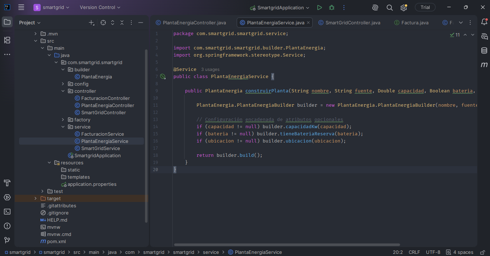

El controlador recibe los parámetros de la petición HTTP y delega la construcción al servicio, que devuelve la planta como respuesta JSON.


### Funcionamiento

1. El cliente envía una petición al endpoint `/api/planta/crear`.
2. El servicio crea un `PlantaEnergiaBuilder` con el nombre y el tipo de fuente.
3. Si se reciben valores opcionales, el servicio configura las propiedades correspondientes.
4. Se invoca `build()` para obtener el objeto `PlantaEnergia`.
5. El controlador devuelve el resultado en formato JSON.

### Ventajas

Builder facilita la construcción de plantas con diferentes configuraciones sin tener que definir múltiples constructores. Además, la clase `PlantaEnergia` utiliza atributos finales, por lo que sus datos no pueden modificarse después de construir la instancia mediante los mecanismos habituales de acceso.

**Alcance actual:** la planta se construye en memoria y se devuelve en la respuesta HTTP; esta operación no implica su persistencia en PostgreSQL.

### Diagrama UML

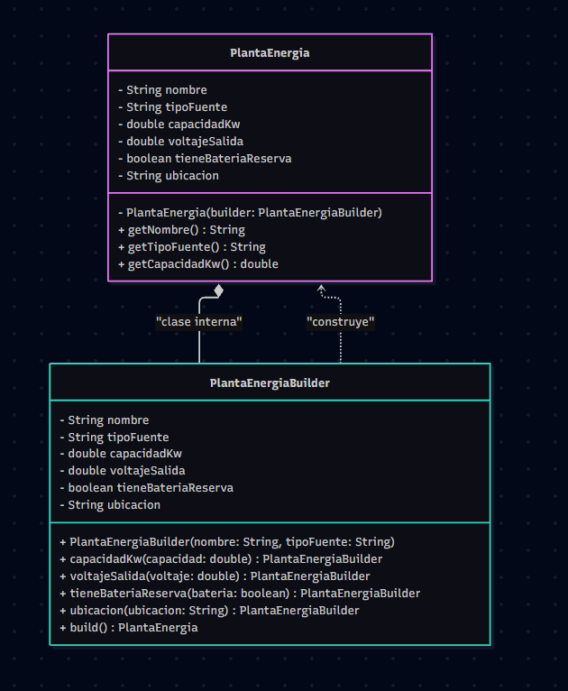

### Video patrón Builder

[](https://www.youtube.com/watch?v=ghf-MfEC9mA)

---


No todos los patrones de diseño aportan beneficios a todos los sistemas. En SmartGrid también se han evaluado patrones que, por las necesidades actuales del proyecto, no se han incorporado a la implementación.

### Abstract Factory

Abstract Factory permite crear familias de objetos relacionados sin depender de sus clases concretas. No se implementa actualmente porque los módulos de configuración, facturación y construcción de plantas no requieren crear familias de objetos relacionados como una unidad. Añadir una jerarquía de fábricas adicionales incrementaría la complejidad sin resolver una necesidad actual del sistema.

### Prototype

Prototype permite crear objetos mediante la clonación de instancias existentes. No se implementa actualmente porque la construcción de las plantas ya está cubierta por Builder, que permite configurar explícitamente los atributos obligatorios y opcionales. En el alcance actual no existe una necesidad concreta de duplicar plantas a partir de prototipos existentes.


### Patrón Adapter

El patrón Adapter se implementa en Smart Grid dentro del módulo de autenticación. Su objetivo es permitir que el proceso de autenticación trabaje mediante una interfaz común, separando la lógica utilizada para validar los usuarios de los componentes que consumen este servicio.

La aplicación define la interfaz `Autenticacion`, la cual establece el contrato mediante el método `autenticar(String username, String password)`. Esta interfaz permite que el sistema trabaje con una abstracción de autenticación sin depender directamente de la forma en que se almacenan o validan los usuarios.

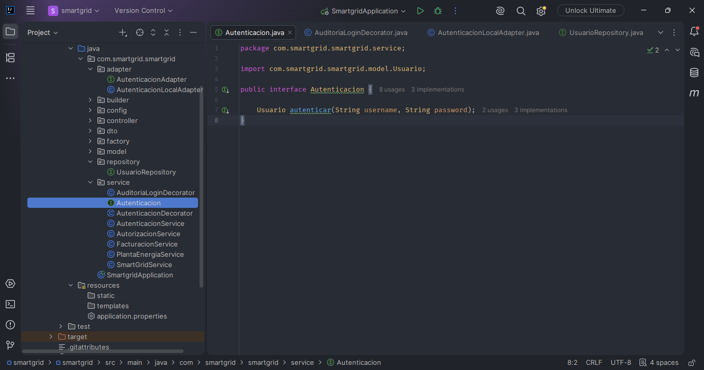

La implementación concreta se encuentra en `AutenticacionLocalAdapter`, ubicada dentro del paquete `adapter`. Esta clase implementa la interfaz `Autenticacion` y adapta el proceso de autenticación local utilizando `UsuarioRepository` y `PasswordEncoder`.

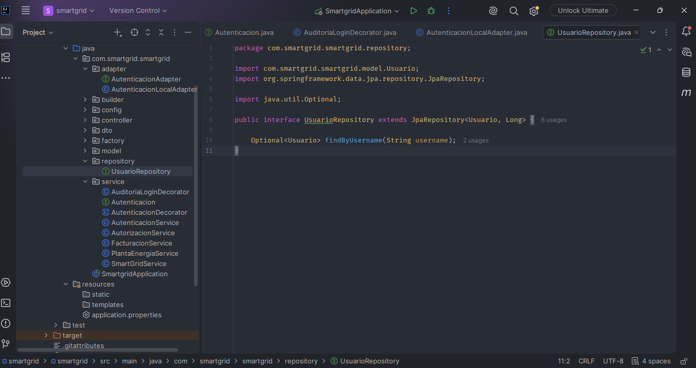

Cuando el usuario intenta iniciar sesión, el Adapter busca el usuario mediante `UsuarioRepository`, verifica que se encuentre activo y posteriormente comprueba la contraseña utilizando BCrypt. Si las credenciales son correctas, retorna el objeto `Usuario`; de lo contrario, retorna un resultado nulo.


Por su parte, `AutenticacionService` trabaja con la abstracción `Autenticacion` y no necesita conocer directamente la implementación utilizada para realizar la autenticación. De esta manera, el servicio puede utilizar el Adapter sin quedar acoplado directamente al repositorio o a la lógica de validación de contraseñas.

El flujo de autenticación queda organizado de la siguiente manera:

`AuthController → AutenticacionService → AutenticacionLocalAdapter → UsuarioRepository → PostgreSQL`

Esta estructura permite que en el futuro se pueda agregar otra forma de autenticación, como una autenticación mediante un servicio externo, creando un nuevo Adapter que implemente la misma interfaz sin modificar el controlador ni la lógica principal del servicio.

### Patrón Decorator

El patrón Decorator se implementa en Smart Grid como complemento del sistema de autenticación. Su finalidad es permitir agregar una responsabilidad adicional al proceso de inicio de sesión sin modificar directamente la implementación original de la autenticación.

Para esto se utiliza la clase abstracta `AutenticacionDecorator`, que implementa la interfaz `Autenticacion` y mantiene una referencia hacia otra implementación de la misma interfaz. Esto permite envolver el comportamiento existente y agregar nuevas funcionalidades.

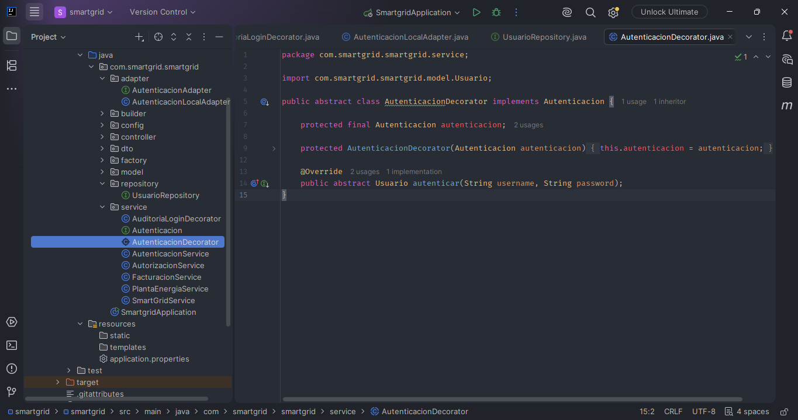

La implementación concreta es `AuditoriaLoginDecorator`. Esta clase recibe `AutenticacionLocalAdapter` y ejecuta primero el proceso normal de autenticación. Después de obtener el resultado, agrega la funcionalidad de auditoría registrando en consola si el inicio de sesión fue exitoso o fallido.

Por ejemplo, cuando el usuario `admin` inicia sesión correctamente, se registra:

`[AUDITORIA] Inicio de sesión exitoso: admin`

Si las credenciales son incorrectas, se registra:

`[AUDITORIA] Intento de inicio de sesión fallido: admin`

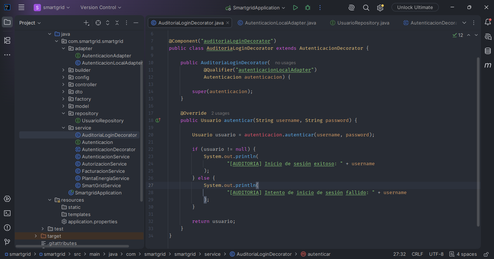


La principal ventaja de esta implementación es que la auditoría se agrega sin modificar `AutenticacionLocalAdapter`. El Decorator funciona como una capa adicional alrededor del proceso original.

El flujo queda organizado de la siguiente manera:

`AuthController → AutenticacionService → AuditoriaLoginDecorator → AutenticacionLocalAdapter → UsuarioRepository`

De esta manera, si posteriormente se necesita agregar otra responsabilidad al inicio de sesión, como registrar estadísticas o generar otro tipo de registro, se puede implementar mediante otro Decorator sin modificar la lógica original de autenticación.

### Diagrama UML Adapter y Decorator

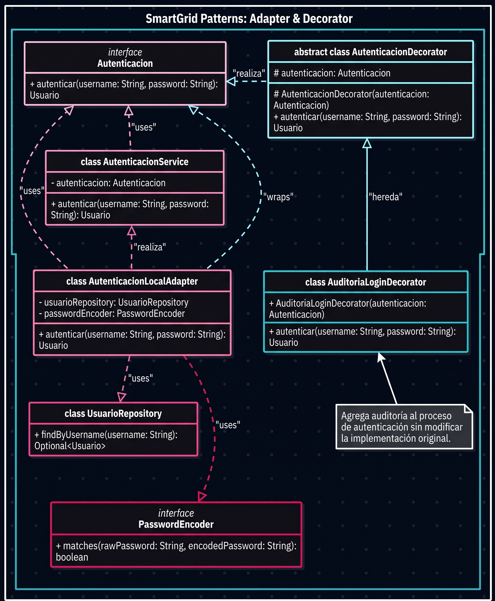

### Video Patrón Adapter y Decorator

[](https://www.youtube.com/watch?v=SI6Rr6OUCIs)

---


### Patrón Bridge

El patrón Bridge permite separar una abstracción de su implementación, permitiendo que ambas puedan evolucionar de manera independiente. Es especialmente útil cuando existen dos dimensiones de variación que pueden cambiar por separado y que generarían múltiples combinaciones de clases si permanecieran acopladas.

Después de analizar la arquitectura actual de Smart Grid, se decidió no implementar este patrón debido a que el sistema no presenta actualmente dos jerarquías independientes que necesiten evolucionar de forma separada.

Los componentes implementados, como la autenticación, las facturas, las plantas de energía y la configuración general del sistema, tienen responsabilidades concretas y no requieren separar una abstracción de diferentes implementaciones independientes.

Implementar Bridge en este punto implicaría agregar abstracciones, interfaces e implementaciones adicionales que no solucionarían un problema existente dentro del proyecto.

Por esta razón, se decidió no utilizar este patrón para evitar aumentar innecesariamente la complejidad de la arquitectura.

### Patrón Composite

El patrón Composite permite representar estructuras jerárquicas de objetos en las cuales tanto los elementos individuales como los grupos de elementos pueden ser tratados mediante una misma interfaz.

Un ejemplo común sería una estructura de archivos donde una carpeta puede contener archivos y otras carpetas, permitiendo tratar ambos elementos como componentes de una misma estructura.

En Smart Grid no se presenta actualmente una estructura jerárquica de este tipo. Las entidades y componentes desarrollados, como usuarios, facturas y plantas de energía, funcionan como elementos independientes y no necesitan formar una estructura de árbol donde un objeto contenga otros objetos del mismo tipo.

Por ejemplo, una `PlantaEnergia` no contiene otras plantas que deban ser tratadas como una única estructura, ni una factura contiene otras facturas que necesiten ser administradas mediante una composición jerárquica.

Por esta razón, implementar Composite únicamente para demostrar el patrón generaría clases y estructuras adicionales sin aportar una solución a una necesidad real del sistema.

Se decidió no utilizar este patrón y mantener la arquitectura enfocada en las relaciones y responsabilidades que realmente necesita Smart Grid.

## Patrón Facade 

Se implementó el patrón de diseño estructural **Facade** para simplificar el acceso a las funcionalidades principales del sistema SmartGrid. Este patrón proporciona un punto de entrada unificado que coordina las operaciones de diferentes servicios del backend.

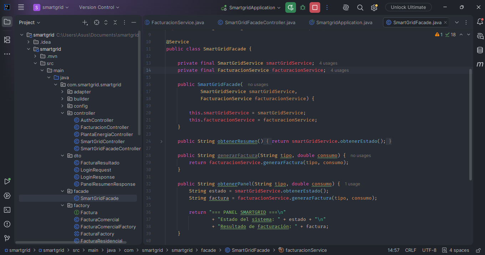

El frontend desarrollado en Angular realiza una petición HTTP al backend. El controlador recibe la solicitud y delega la operación a `SmartGridFacade`, que coordina las llamadas a los servicios correspondientes.

La fachada reúne los resultados y permite devolver una respuesta estructurada en formato JSON, que Angular utiliza para actualizar la información del panel sin recargar la página.

### Endpoints implementados

| Método HTTP | Endpoint                 | Función                                                                    |
| ----------- | ------------------------ | -------------------------------------------------------------------------- |
| GET         | `/api/facade/resumen`    | Consulta un resumen del sistema.                                           |
| GET         | `/api/facade/panel`      | Obtiene la información del panel en formato de texto.                      |
| GET         | `/api/facade/panel-json` | Devuelve el estado del sistema y los datos de facturación en formato JSON. |

El endpoint `/api/facade/panel-json` acepta los parámetros `tipo` y `consumo`. Si no se especifican, utiliza los valores predeterminados `RESIDENCIAL` y `350`, respectivamente.

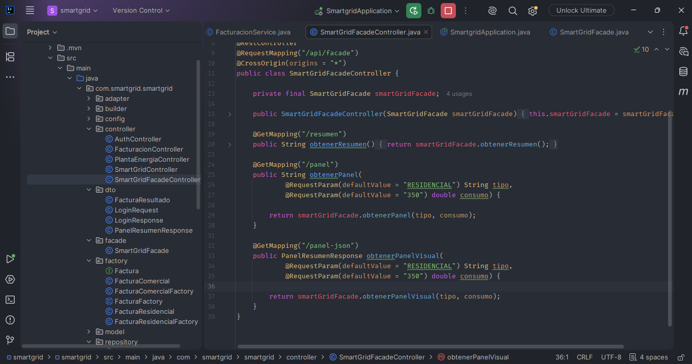

**Ejemplo de consulta:**

```http
GET http://localhost:8080/api/facade/panel-json?tipo=RESIDENCIAL&consumo=350
```

**Respuesta esperada:**

```json
{
  "estadoSistema": "SmartGrid está activo",
  "factura": {
    "tipoFactura": "RESIDENCIAL",
    "consumo": 350.0,
    "tarifa": 500.0,
    "total": 175000.0
  }
}
```

### Integración con Angular

Se desarrolló un panel de control que consume el endpoint `/api/facade/panel-json` mediante `HttpClient`.

La interfaz permite:

* Consultar el estado del sistema SmartGrid.
* Seleccionar facturación residencial o comercial.
* Ingresar el consumo energético en kWh.
* Visualizar la tarifa aplicada y el total de la factura.
* Actualizar los resultados sin recargar la página.

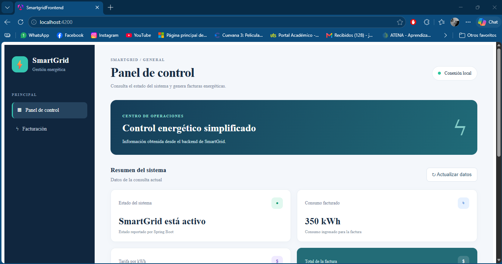

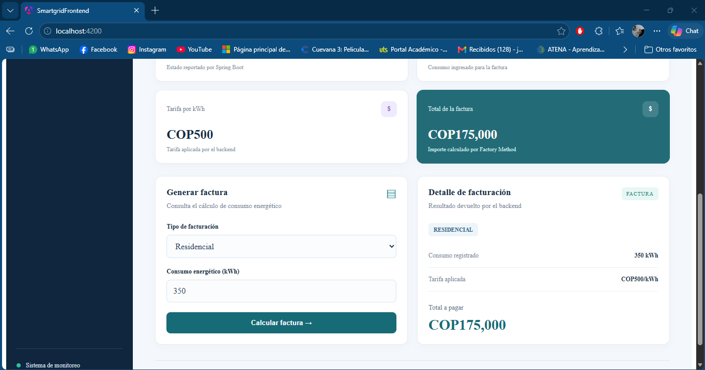

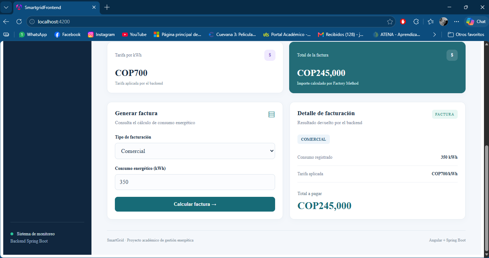

### Ventajas

* Simplifica la interacción entre el controlador y los servicios del backend.
* Centraliza la coordinación de las operaciones relacionadas con el panel.
* Reduce el acoplamiento entre los componentes.
* Facilita el mantenimiento y la integración con el frontend.
* Permite reutilizar los servicios sin duplicar su lógica de negocio.

### Diagrama UML Facade 

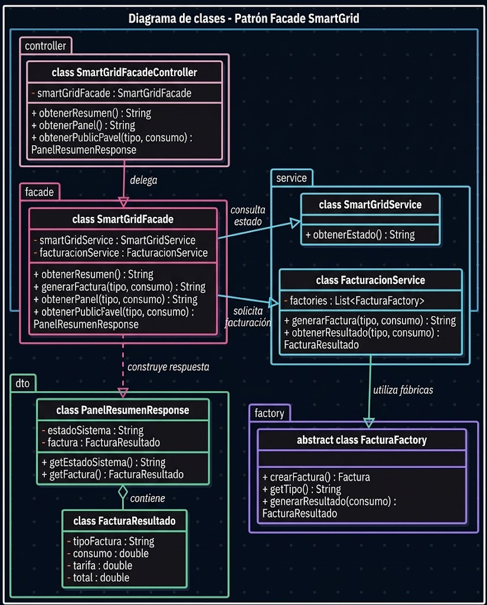

La implementación de Facade demuestra cómo una fachada puede ofrecer una interfaz simplificada para acceder a varias funcionalidades de un sistema, manteniendo separadas las responsabilidades de consulta del estado y cálculo de facturación.

### Video Patrón Facade

[](https://www.youtube.com/watch?v=WedsvCXpcdo)

---


## Patrón Flyweight

### Propósito

El patrón estructural Flyweight permite compartir objetos que contienen información común entre múltiples instancias, reduciendo la creación de objetos duplicados y el consumo de memoria.

### Implementación en SmartGrid

En SmartGrid, Flyweight se utiliza para compartir la información común de las fuentes de energía de las plantas. Por ejemplo, varias plantas solares pueden reutilizar el mismo objeto con la descripción y las características de la energía solar.

**Clases involucradas:**

- `FuenteEnergiaFlyweight`: almacena la información compartida de una fuente energética, incluyendo su tipo, descripción y características.
- `FuenteEnergiaFactory`: administra los objetos compartidos mediante un `HashMap` y reutiliza el objeto correspondiente al tipo de fuente solicitado.
- `PlantaEnergia`: integra Flyweight con el patrón Builder y mantiene una referencia al objeto compartido de su fuente energética.
- `FlyweightTest`: comprueba que dos plantas solares reutilizan la misma instancia de `FuenteEnergiaFlyweight`.

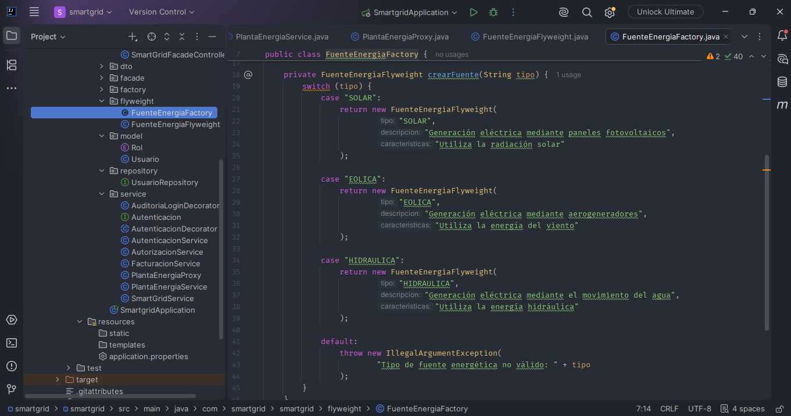

### Funcionamiento

Cuando se construye una planta, `PlantaEnergia` solicita a `FuenteEnergiaFactory` el objeto correspondiente a su fuente energética. Si ya existe, se reutiliza; de lo contrario, se crea y se almacena para futuras solicitudes.

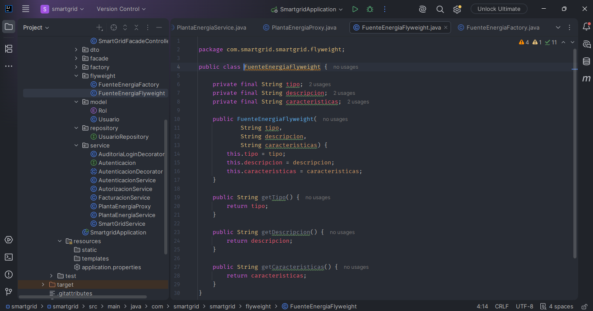

La comparación mediante `==` en la prueba automatizada permite verificar que dos plantas solares hacen referencia al mismo objeto en memoria.

### Prueba realizada

La prueba `FlyweightTest` finalizó correctamente con el resultado **Test passed**, confirmando la reutilización de la instancia para dos plantas solares.

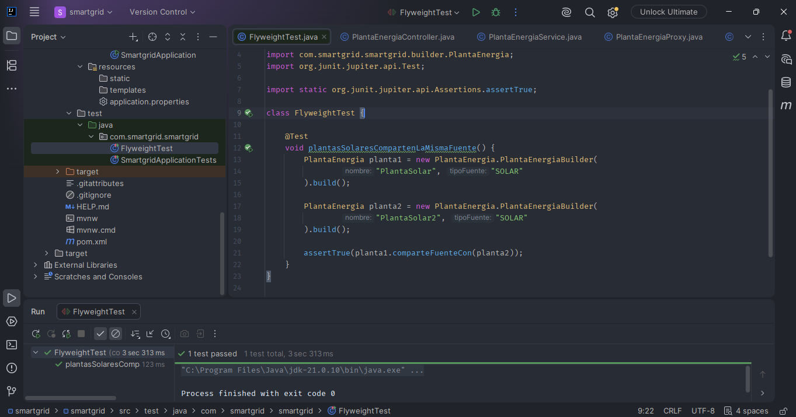

**Alcance actual:** las plantas se construyen en memoria y todavía no se persisten en la base de datos.

### Diagrama UML Flyweight

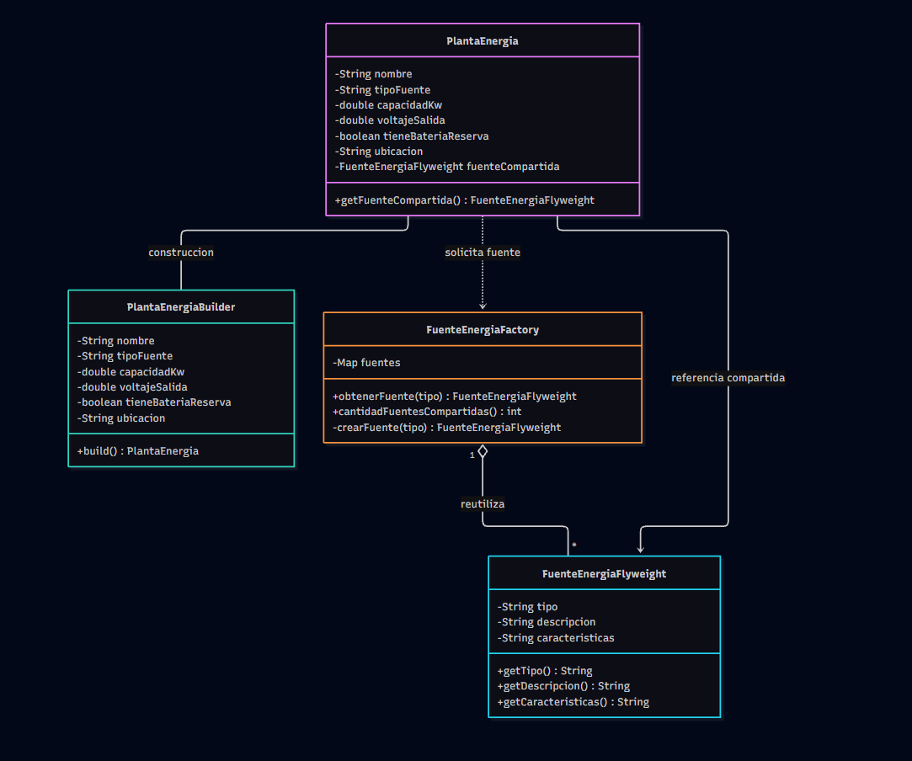

---

### Video patrón Flayweight

[](https://www.youtube.com/watch?v=15xdZdC2LHo)

---

## Patrón Proxy

### Propósito

El patrón estructural Proxy proporciona un intermediario que controla el acceso a un objeto o servicio real antes de delegarle una operación.

### Implementación en SmartGrid

En SmartGrid, Proxy controla el acceso a la construcción de plantas energéticas según el rol del usuario. Solamente los usuarios activos con el rol `ADMIN` pueden ejecutar esta operación.

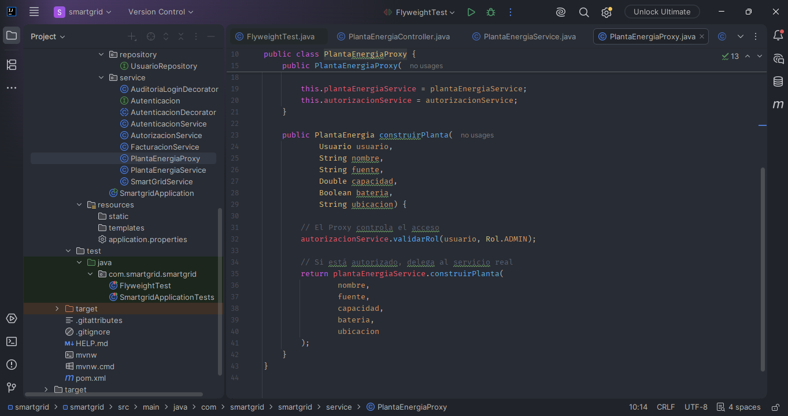

**Clases involucradas:**

- `PlantaEnergiaController`: recibe la solicitud HTTP y busca al usuario en la base de datos mediante `UsuarioRepository`.
- `PlantaEnergiaProxy`: actúa como intermediario, valida los permisos del usuario y delega la operación al servicio real.
- `AutorizacionService`: comprueba que el usuario esté activo y tenga el rol requerido. Si no cumple las condiciones, genera una respuesta HTTP `403 Forbidden`.
- `PlantaEnergiaService`: construye la planta utilizando el patrón Builder.


### Funcionamiento

1. El controlador recibe la solicitud para construir una planta.
2. Se busca el usuario por su nombre de usuario.
3. El controlador entrega el usuario y los datos de la planta a `PlantaEnergiaProxy`.
4. El Proxy solicita a `AutorizacionService` la validación del rol `ADMIN`.
5. Si el usuario está autorizado, el Proxy delega la construcción a `PlantaEnergiaService`.
6. Si el usuario no está autorizado o está inactivo, la operación se rechaza con HTTP `403 Forbidden`.

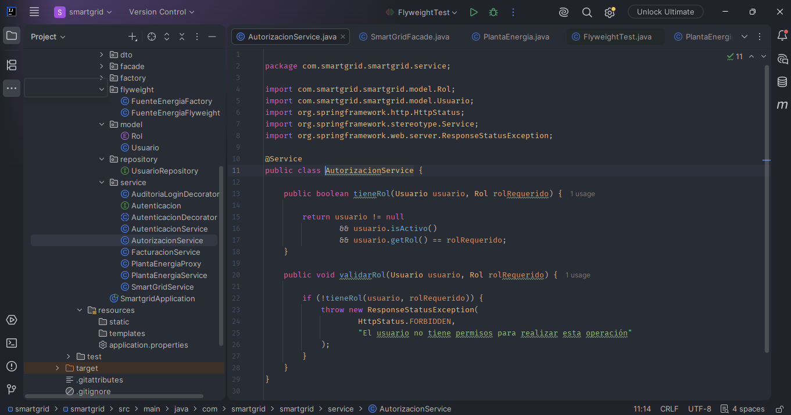

### Pruebas realizadas

| Usuario | Resultado | Descripción |
|---|---|---|
| `admin` | HTTP 200 OK | Se permite construir la planta. |
| `operador` | HTTP 403 Forbidden | Se rechaza la operación por falta de autorización. |

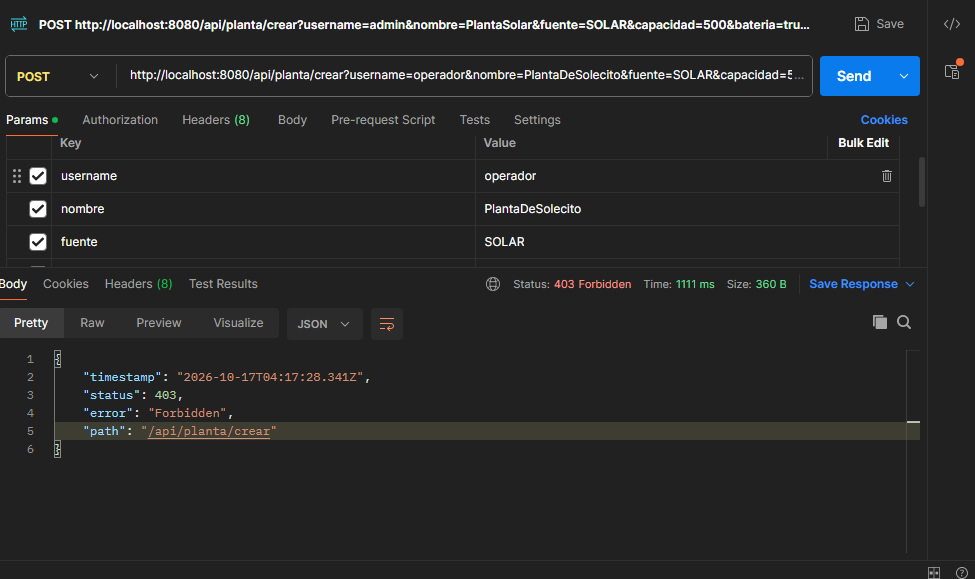

**Alcance actual:** Proxy controla el acceso a la construcción de plantas, pero estas todavía no se guardan en PostgreSQL. La autorización se basa en el usuario y su rol recuperados de la base de datos; no representa por sí sola un sistema completo de autenticación y seguridad HTTP.

### Diagrama UML Proxy

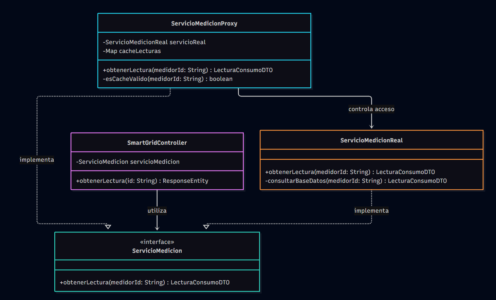

---

### Video patrón Proxy

[](https://www.youtube.com/watch?v=dnaba2vTqcw)

---

# Ejecución del proyecto SmartGrid

## 1. Requisitos

Para ejecutar el proyecto SmartGrid se necesitan las siguientes herramientas:

* **IntelliJ IDEA** o Visual Studio Code.
* **Java JDK 21**.
* **PostgreSQL**.
* **pgAdmin 4**.
* Conexión a Internet para descargar las dependencias de Maven.

En este proyecto se utilizó principalmente **IntelliJ IDEA** para el desarrollo y **PostgreSQL** como sistema gestor de bases de datos.

---

# 2. Descargar el proyecto

El código fuente del proyecto se encuentra disponible en GitHub.

### Código fuente de SmartGrid

[Descargar proyecto SmartGrid](https://github.com/juandpl18/Proyecto_Patrones/tree/main/smartgrid/smartgrid)

También se encuentra dentro del repositorio principal:

```text
Proyecto_Patrones
│
├── smartgrid
│   └── smartgrid
│
└── Base de datos
    └── smartgrid.sql
```

Se puede descargar el repositorio completo utilizando el botón **Code → Download ZIP** de GitHub o mediante Git:

```bash
git clone https://github.com/juandpl18/Proyecto_Patrones.git
```

Después de descargarlo, se debe localizar la carpeta:

```text
Proyecto_Patrones/smartgrid/smartgrid
```

---

# 3. Abrir el proyecto en IntelliJ IDEA

1. Abrir **IntelliJ IDEA**.
2. Seleccionar:

```text
File → Open
```

3. Buscar la carpeta:

```text
Proyecto_Patrones/smartgrid/smartgrid
```

4. Seleccionar la carpeta y abrir el proyecto.
5. IntelliJ detectará el archivo:

```text
pom.xml
```

6. Esperar a que Maven descargue todas las dependencias necesarias.

El proyecto está desarrollado con **Spring Boot**, por lo que Maven se encargará de descargar las librerías definidas en `pom.xml`.

---

# 4. Verificar Java

El proyecto utiliza **Java 21**.

En IntelliJ se debe verificar:

```text
File → Project Structure → Project
```

y comprobar que el SDK seleccionado sea:

```text
Java 21
```

También se puede verificar desde la terminal:

```bash
java -version
```

Debe aparecer una versión correspondiente a Java 21.

---

# 5. Instalar y preparar PostgreSQL

El proyecto utiliza PostgreSQL como base de datos.

Abrir **pgAdmin 4** y conectarse al servidor PostgreSQL.

Crear una nueva base de datos llamada:

```text
smartgrid
```

La estructura debe quedar:

```text
Servers
└── PostgreSQL
    └── Databases
        └── smartgrid
```

---

# 6. Importar la base de datos

Dentro del repositorio se encuentra el archivo:

[smartgrid.sql](https://github.com/juandpl18/Proyecto_Patrones/blob/main/Base%20de%20datos/smartgrid.sql)

ubicado en:

```text
Base de datos/smartgrid.sql
```

Este archivo corresponde al respaldo de la base de datos PostgreSQL.

Para restaurarlo desde pgAdmin se puede utilizar **Query Tool** y ejecutar el contenido del archivo SQL.

También se puede utilizar la opción de restauración de PostgreSQL cuando el formato del respaldo lo permita.

> **Nota:** antes de ejecutar el proyecto se debe comprobar que el archivo `smartgrid.sql` contenga las instrucciones `CREATE TABLE`, restricciones y, si corresponde, los datos de prueba. Si el archivo solo contiene la cabecera del `pg_dump`, se debe generar nuevamente el respaldo desde pgAdmin.

---

# 7. Configurar la conexión con PostgreSQL

Dentro del proyecto se encuentra:

```text
src
└── main
    └── resources
        └── application.properties
```

La configuración debe apuntar a la base de datos `smartgrid`.

Ejemplo:

```properties
spring.application.name=smartgrid

spring.datasource.url=jdbc:postgresql://localhost:5432/smartgrid
spring.datasource.username=postgres
spring.datasource.password=TU_CONTRASEÑA

spring.jpa.hibernate.ddl-auto=update
spring.jpa.show-sql=true
spring.jpa.properties.hibernate.format_sql=true
```

Se debe reemplazar:

```text
TU_CONTRASEÑA
```

por la contraseña correspondiente al usuario de PostgreSQL.

## Importante

No se debe publicar una contraseña real de PostgreSQL en GitHub.

Para una instalación local se puede utilizar la contraseña propia de cada equipo.

---

# 8. Verificar la conexión con PostgreSQL

Antes de ejecutar el proyecto, comprobar que:

* PostgreSQL esté ejecutándose.
* La base de datos se llame `smartgrid`.
* El puerto sea `5432`, salvo que se haya configurado otro.
* El usuario de PostgreSQL sea correcto.
* La contraseña sea correcta.
* La URL de conexión coincida con la configuración de `application.properties`.

La configuración utilizada originalmente por el proyecto es:

```text
Host: localhost
Puerto: 5432
Base de datos: smartgrid
Usuario: postgres
```

---

# 9. Ejecutar SmartGrid

En IntelliJ localizar la clase principal del proyecto:

```text
src
└── main
    └── java
        └── com.smartgrid.smartgrid
            └── SmartgridApplication.java
```

Abrir la clase y presionar:

```text
▶ Run
```

También se puede ejecutar desde Maven mediante:

```bash
mvn spring-boot:run
```

Si la ejecución es correcta, en la consola de IntelliJ aparecerá el inicio de Spring Boot y el servidor quedará disponible normalmente en:

```text
http://localhost:8080
```

---

# 10. Comprobar que SmartGrid está funcionando

Una vez iniciado el proyecto, se pueden utilizar los endpoints disponibles en el proyecto.

Por ejemplo, para consultar el estado del sistema:

```text
http://localhost:8080/smartgrid/estado
```

Si el sistema está activo, se mostrará:

```text
SmartGrid está ACTIVO
```

Este endpoint permite comprobar también el funcionamiento del patrón **Singleton**, ya que el estado se obtiene desde la instancia única de `SmartGridConfig`.

---

# 11. Probar el patrón Factory Method

El patrón Factory Method se implementó en el módulo de facturación.

Para generar una factura residencial:

```text
http://localhost:8080/facturacion/generar?tipo=RESIDENCIAL&consumo=350
```

Para una factura comercial:

```text
http://localhost:8080/facturacion/generar?tipo=COMERCIAL&consumo=350
```

El sistema selecciona la fábrica correspondiente y genera el tipo de factura solicitado.

La estructura principal es:

```text
FacturaFactory
├── FacturaResidencialFactory
│   └── FacturaResidencial
│
└── FacturaComercialFactory
    └── FacturaComercial
```

---

# 12. Probar el patrón Builder

El patrón Builder se implementó en la construcción de una `PlantaEnergia`.

El endpoint utilizado es:

```text
/api/planta/crear
```

Por ejemplo:

```text
http://localhost:8080/api/planta/crear?nombre=PlantaSolar&fuente=SOLAR&capacidad=1000&bateria=true&ubicacion=Bucaramanga
```

El controlador recibe los parámetros y el servicio utiliza `PlantaEnergiaBuilder` para construir el objeto.

El proceso es:

```text
Controller
    ↓
PlantaEnergiaService
    ↓
PlantaEnergiaBuilder
    ↓
build()
    ↓
PlantaEnergia
```

El resultado se devuelve como un objeto JSON.

---

# 13. Estructura general del proyecto

La estructura principal de SmartGrid es:

```text
smartgrid
│
├── src
│   └── main
│       ├── java
│       │   └── com.smartgrid.smartgrid
│       │       ├── builder
│       │       │   └── PlantaEnergia.java
│       │       │
│       │       ├── config
│       │       │   └── SmartGridConfig.java
│       │       │
│       │       ├── controller
│       │       │
│       │       ├── factory
│       │       │   ├── Factura.java
│       │       │   ├── FacturaFactory.java
│       │       │   ├── FacturaResidencial.java
│       │       │   ├── FacturaResidencialFactory.java
│       │       │   ├── FacturaComercial.java
│       │       │   └── FacturaComercialFactory.java
│       │       │
│       │       └── service
│       │
│       └── resources
│           └── application.properties
│
├── pom.xml
└── README.md
```

---

# 14. Patrones de diseño implementados

Actualmente SmartGrid implementa los siguientes patrones:

### Singleton

Utilizado para controlar la configuración y el estado global de SmartGrid.

```text
SmartGridConfig
```

### Factory Method

Utilizado en el módulo de facturación para crear diferentes tipos de factura.

```text
FacturaFactory
├── FacturaResidencialFactory
└── FacturaComercialFactory
```

### Builder

Utilizado para construir objetos `PlantaEnergia` de manera flexible y ordenada.

```text
PlantaEnergia
└── PlantaEnergiaBuilder
```

Otros patrones como **Prototype** y **Abstract Factory** no fueron incorporados debido a que actualmente no existe una necesidad funcional dentro del proyecto que justifique su utilización. De esta manera se evita agregar clases o funcionalidades únicamente para demostrar un patrón y se mantiene el diseño enfocado en las necesidades reales de SmartGrid.

---

# 15. Resumen de ejecución

El proceso completo para ejecutar el proyecto es:

```text
1. Descargar/clonar el repositorio
        ↓
2. Abrir smartgrid/smartgrid en IntelliJ IDEA
        ↓
3. Verificar Java 21
        ↓
4. Instalar/iniciar PostgreSQL
        ↓
5. Crear la base de datos smartgrid
        ↓
6. Importar smartgrid.sql
        ↓
7. Configurar application.properties
        ↓
8. Verificar usuario y contraseña de PostgreSQL
        ↓
9. Ejecutar SmartgridApplication
        ↓
10. Acceder a localhost:8080
        ↓
11. Probar los endpoints
```

Con estos pasos se puede descargar, configurar y ejecutar el proyecto SmartGrid en un equipo diferente al utilizado durante el desarrollo.


