# Proyecto de Patrones de Diseño de Software

Los patrones de diseño de software son soluciones reutilizables que permiten abordar problemas recurrentes durante el diseño y desarrollo de aplicaciones. No constituyen código listo para copiar y pegar, sino modelos de diseño que orientan la organización de las clases, la distribución de responsabilidades y la interacción entre los componentes de un sistema.

La aplicación adecuada de estos patrones contribuye a mejorar la mantenibilidad, la reutilización del código, la flexibilidad y la capacidad de evolución del software. Sin embargo, cada patrón debe seleccionarse de acuerdo con las necesidades del sistema, evitando introducir complejidad innecesaria.

Este proyecto tiene como propósito estudiar e implementar progresivamente diferentes patrones de diseño sobre **SmartGrid**, un sistema de gestión de redes eléctricas inteligentes. A través de estas implementaciones se busca comprender su funcionamiento, identificar los problemas que resuelven y evaluar cómo contribuyen a la estructura y organización de una aplicación.

## Organización del proyecto

El desarrollo se organiza por semanas. Cada directorio correspondiente a una semana contiene los avances y evidencias del trabajo realizado, permitiendo conservar un registro de la evolución del proyecto.

- **Proyecto principal:** `smartgrid/smartgrid`
- **Base de datos:** carpeta `Base de datos`
- **Documentación y evidencias:** directorios semanales y recursos incluidos en el repositorio.

Los patrones se incorporan de manera progresiva sobre el proyecto principal, procurando conservar las funcionalidades existentes y mantener una estructura organizada.

## SmartGrid

SmartGrid es un sistema de gestión de redes eléctricas inteligentes orientado a la administración de la infraestructura energética, la gestión del consumo y la integración de fuentes de energía renovable.

El proyecto se desarrolla progresivamente mediante la implementación de patrones de diseño que permiten organizar las responsabilidades del backend, reducir el acoplamiento entre componentes y facilitar el mantenimiento y la incorporación de nuevas funcionalidades.

La aplicación cuenta con un backend desarrollado con **Java y Spring Boot**, una base de datos **PostgreSQL** y una interfaz web desarrollada con **Angular**.

Las funcionalidades y los patrones implementados se documentan a lo largo de este README, incluyendo sus objetivos, las clases involucradas, los diagramas UML y las evidencias de funcionamiento disponibles.

> **Nota:** las instrucciones para descargar, configurar y ejecutar SmartGrid se encuentran al final de este documento.

### Objetivo general

Desarrollar progresivamente un sistema de gestión de redes eléctricas inteligentes que permita administrar información relacionada con el consumo energético, la infraestructura de generación, las fuentes de energía renovable y la facturación, utilizando patrones de diseño de software para mejorar la organización, mantenibilidad y extensibilidad de la aplicación.

### Objetivos específicos

- Diseñar mecanismos para consultar y visualizar información relacionada con el consumo energético.
- Establecer una estructura que permita incorporar funcionalidades de gestión de la demanda y balanceo de cargas.
- Modelar la infraestructura de generación eléctrica y facilitar la representación de fuentes renovables, como la solar y la eólica.
- Implementar mecanismos de facturación que permitan calcular los costos del consumo de acuerdo con las tarifas y los parámetros definidos.
- Desarrollar un panel web para consultar información y funcionalidades disponibles en el sistema.
- Aplicar y documentar patrones de diseño que favorezcan la separación de responsabilidades, la reutilización del código y la evolución de la arquitectura.
- Verificar las implementaciones mediante pruebas y solicitudes a los endpoints REST, documentando los resultados obtenidos.

## Patrones de diseño implementados

A lo largo del proyecto se incorporan patrones de diseño seleccionados de acuerdo con las necesidades de SmartGrid. Cada implementación incluye una descripción de su propósito, su aplicación dentro del sistema y los componentes principales que participan en ella.


## Patrón Singleton

### Propósito

El patrón creacional Singleton permite controlar la creación de instancias de una clase cuando se requiere un único objeto compartido para una responsabilidad determinada. Su objetivo es centralizar el acceso a ese objeto y evitar la creación de múltiples instancias independientes.

### Implementación en SmartGrid

En SmartGrid, este patrón se aplica a la clase `SmartGridConfig`, encargada de mantener la configuración general del sistema, como su nombre y su estado de activación.

La clase proporciona un punto de acceso a la configuración para que los componentes que la necesitan consulten o modifiquen sus valores de forma centralizada.

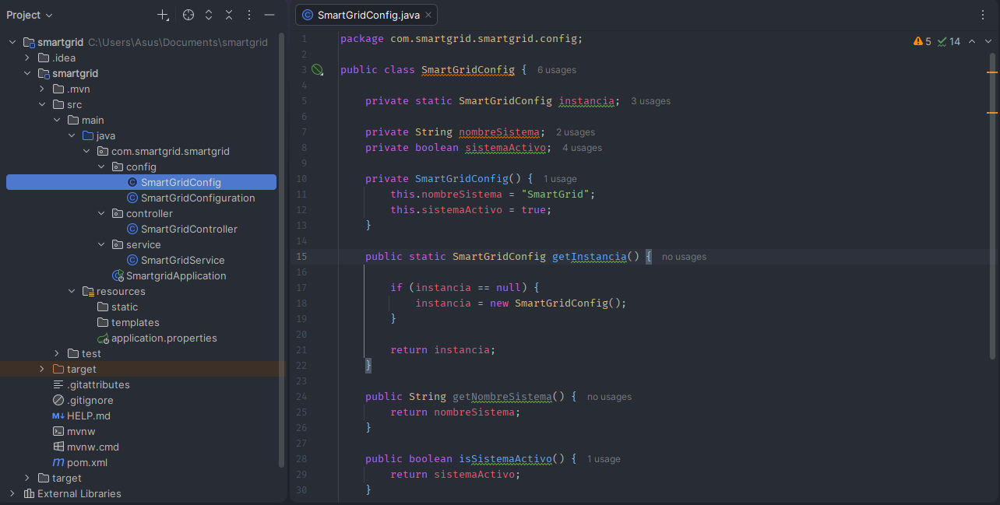

En la implementación del patrón se utiliza una instancia compartida, un constructor privado y el método `getInstancia()`, que permite obtener esa instancia sin crear objetos nuevos desde otras clases.

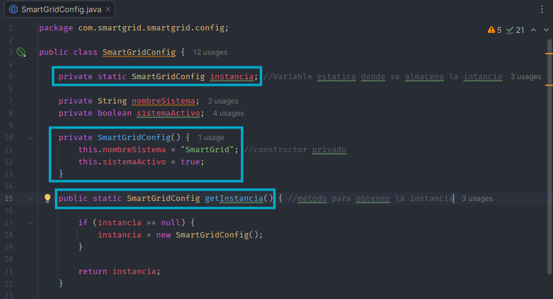

### Diagrama UML

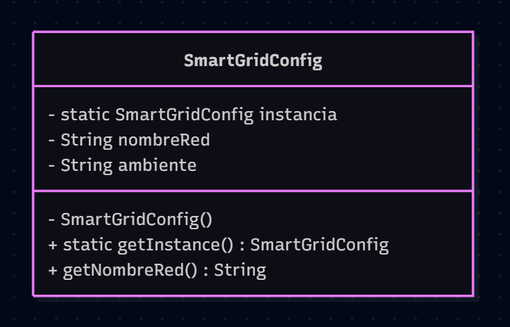

### Video Patrón Singleton

[](https://www.youtube.com/watch?v=1u5A9hnG09Y)

---

## Patrón Factory Method

### Propósito

El patrón creacional Factory Method define un método para crear objetos y delega a las implementaciones concretas la decisión de qué tipo de objeto instanciar. Esto permite separar la creación de los objetos de la lógica que los utiliza.

### Implementación en SmartGrid

En SmartGrid, Factory Method se utiliza en el módulo de facturación para generar facturas de diferentes categorías de clientes, como residenciales y comerciales.

La implementación se encuentra organizada en el paquete `com.smartgrid.smartgrid.factory` y se integra con las capas de servicio y controlador.

### Clases involucradas

- `Factura`: interfaz que define el contrato común para los diferentes tipos de factura.
- `FacturaResidencial` y `FacturaComercial`: productos concretos que implementan el comportamiento específico de cada categoría.
- `FacturaFactory`: creador abstracto que declara el método `crearFactura()`.
- `FacturaResidencialFactory` y `FacturaComercialFactory`: creadores concretos que deciden qué implementación de `Factura` instanciar.
- `FacturacionService`: utiliza la fábrica correspondiente para generar la factura y calcular el valor del consumo.
- `FacturacionController`: expone la funcionalidad mediante el endpoint REST `/api/facturacion`.

La interfaz `Factura` establece el contrato común del producto.

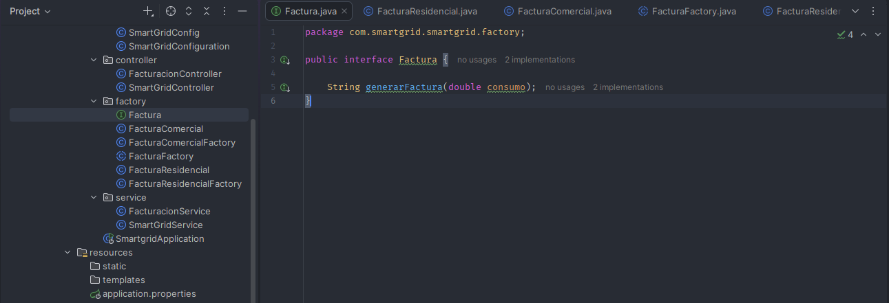

Las clases concretas implementan el comportamiento correspondiente a cada tipo de factura.

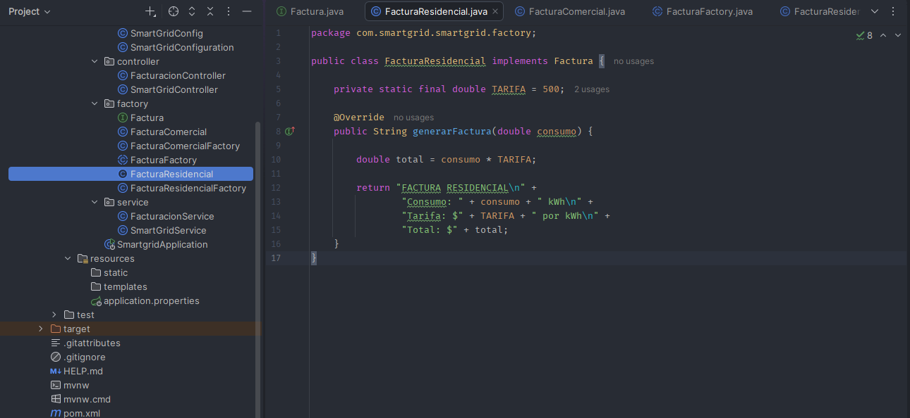

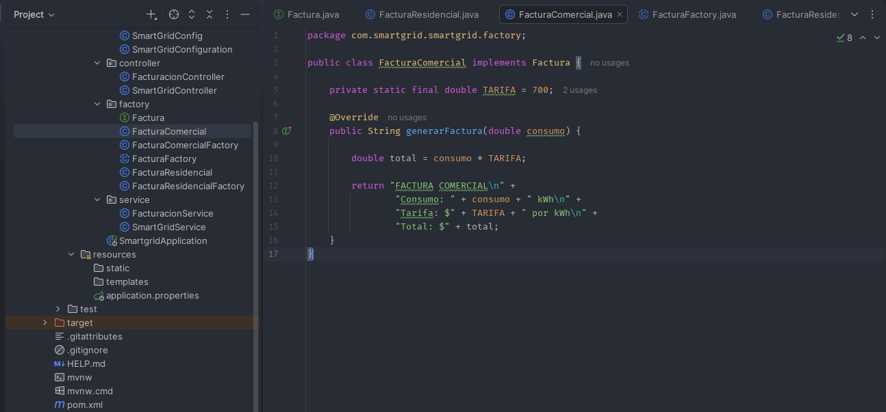

La clase abstracta `FacturaFactory` define el método de creación.

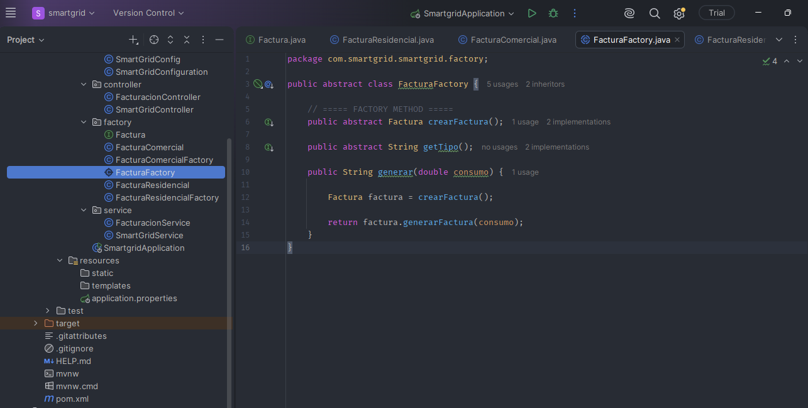

Las fábricas concretas implementan ese método y devuelven el producto correspondiente. De esta forma, `FacturacionService` puede trabajar con la abstracción sin tener que construir directamente cada tipo de factura.

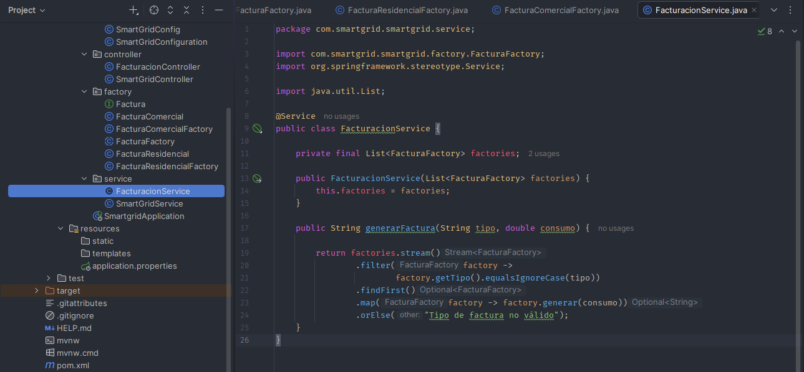

### Funcionamiento

1. El cliente envía una solicitud al endpoint `/api/facturacion`, indicando el tipo de factura y el consumo.
2. El controlador delega el procesamiento a `FacturacionService`.
3. El servicio utiliza la fábrica correspondiente.
4. La fábrica crea una implementación concreta de `Factura`.
5. Se calcula el importe y se devuelve la respuesta en formato JSON.

### Ventajas

La incorporación de un nuevo tipo de factura puede realizarse mediante una nueva implementación de `Factura` y su fábrica correspondiente, reduciendo la necesidad de modificar la lógica que utiliza los productos. La ampliación concreta dependerá de cómo se registre y seleccione la nueva fábrica.

### Diagrama UML

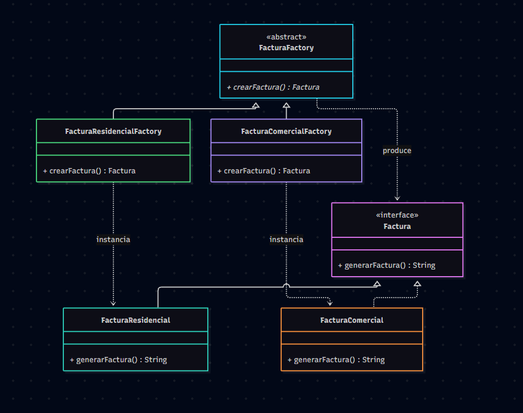

### Video patrón Factory Method

[](https://www.youtube.com/watch?v=Ty08ICiVTJ0)

---

## Patrón Builder

### Propósito

El patrón creacional Builder permite construir objetos complejos paso a paso, separando el proceso de construcción de la representación final del objeto. Es especialmente útil cuando una clase contiene atributos obligatorios y opcionales.

### Implementación en SmartGrid

En SmartGrid, Builder se utiliza para construir objetos `PlantaEnergia`. Este patrón permite especificar los datos obligatorios de una planta y configurar opcionalmente su capacidad, batería de reserva y ubicación.

La implementación se encuentra en la clase `PlantaEnergia.java`, que contiene la clase interna estática `PlantaEnergiaBuilder`.

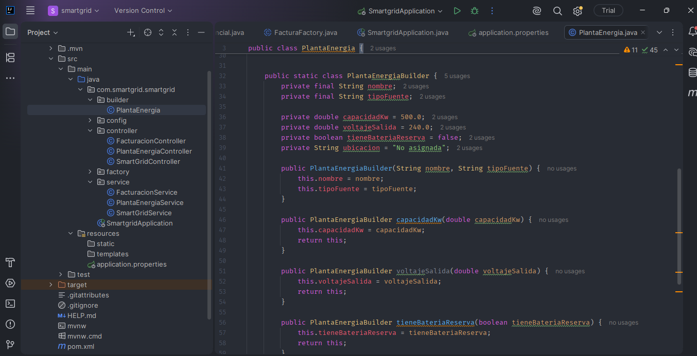

### Clases involucradas

- `PlantaEnergia`: representa la planta energética construida y contiene sus atributos.
- `PlantaEnergiaBuilder`: define los datos requeridos, los valores por defecto y los métodos encadenados para configurar las propiedades.
- `PlantaEnergiaService`: coordina la construcción a partir de los parámetros recibidos.
- `PlantaEnergiaController`: expone la operación mediante el endpoint REST `/api/planta/crear`.

El constructor del builder exige los atributos `nombre` y `tipoFuente`. Los métodos `capacidadKw()`, `voltajeSalida()`, `tieneBateriaReserva()` y `ubicacion()` permiten configurar los demás valores antes de invocar `build()`.

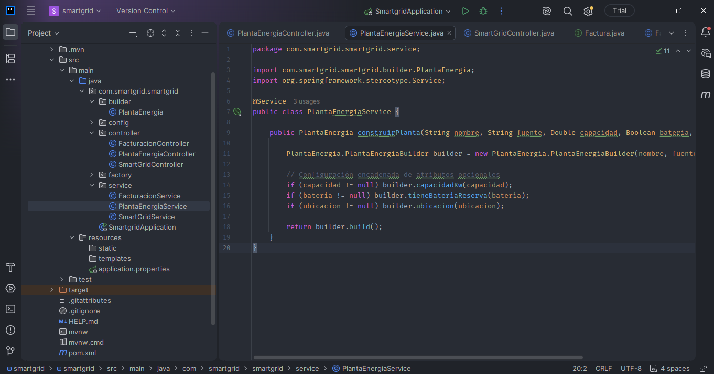

El controlador recibe los parámetros de la petición HTTP y delega la construcción al servicio, que devuelve la planta como respuesta JSON.


### Funcionamiento

1. El cliente envía una petición al endpoint `/api/planta/crear`.
2. El servicio crea un `PlantaEnergiaBuilder` con el nombre y el tipo de fuente.
3. Si se reciben valores opcionales, el servicio configura las propiedades correspondientes.
4. Se invoca `build()` para obtener el objeto `PlantaEnergia`.
5. El controlador devuelve el resultado en formato JSON.

### Ventajas

Builder facilita la construcción de plantas con diferentes configuraciones sin tener que definir múltiples constructores. Además, la clase `PlantaEnergia` utiliza atributos finales, por lo que sus datos no pueden modificarse después de construir la instancia mediante los mecanismos habituales de acceso.

**Alcance actual:** la planta se construye en memoria y se devuelve en la respuesta HTTP; esta operación no implica su persistencia en PostgreSQL.

### Diagrama UML

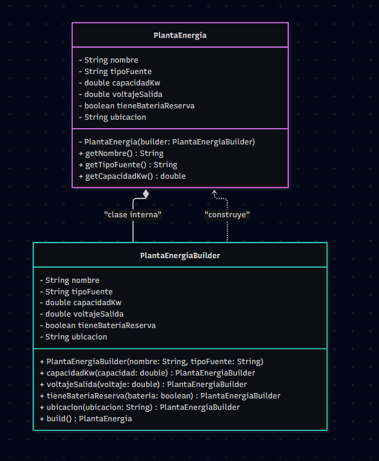

### Video patrón Builder

[](https://www.youtube.com/watch?v=ghf-MfEC9mA)

---


No todos los patrones de diseño aportan beneficios a todos los sistemas. En SmartGrid también se han evaluado patrones que, por las necesidades actuales del proyecto, no se han incorporado a la implementación.

### Abstract Factory

Abstract Factory permite crear familias de objetos relacionados sin depender de sus clases concretas. No se implementa actualmente porque los módulos de configuración, facturación y construcción de plantas no requieren crear familias de objetos relacionados como una unidad. Añadir una jerarquía de fábricas adicionales incrementaría la complejidad sin resolver una necesidad actual del sistema.

### Prototype

Prototype permite crear objetos mediante la clonación de instancias existentes. No se implementa actualmente porque la construcción de las plantas ya está cubierta por Builder, que permite configurar explícitamente los atributos obligatorios y opcionales. En el alcance actual no existe una necesidad concreta de duplicar plantas a partir de prototipos existentes.


### Patrón Adapter

El patrón Adapter se implementa en Smart Grid dentro del módulo de autenticación. Su objetivo es permitir que el proceso de autenticación trabaje mediante una interfaz común, separando la lógica utilizada para validar los usuarios de los componentes que consumen este servicio.

La aplicación define la interfaz `Autenticacion`, la cual establece el contrato mediante el método `autenticar(String username, String password)`. Esta interfaz permite que el sistema trabaje con una abstracción de autenticación sin depender directamente de la forma en que se almacenan o validan los usuarios.

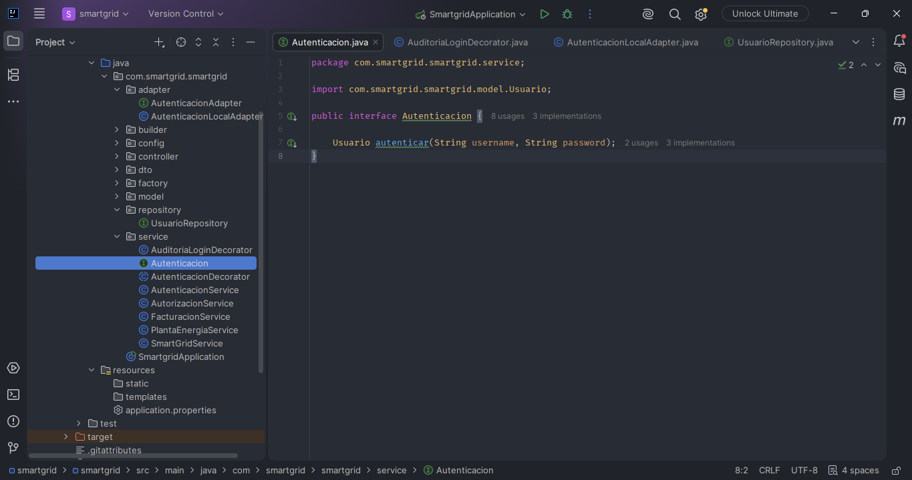

La implementación concreta se encuentra en `AutenticacionLocalAdapter`, ubicada dentro del paquete `adapter`. Esta clase implementa la interfaz `Autenticacion` y adapta el proceso de autenticación local utilizando `UsuarioRepository` y `PasswordEncoder`.

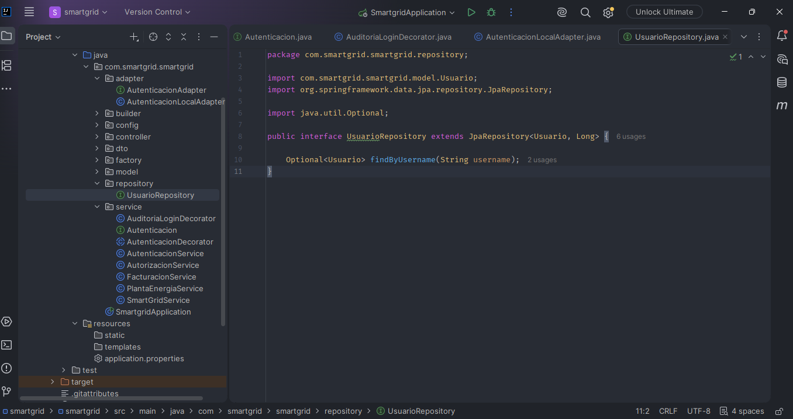

Cuando el usuario intenta iniciar sesión, el Adapter busca el usuario mediante `UsuarioRepository`, verifica que se encuentre activo y posteriormente comprueba la contraseña utilizando BCrypt. Si las credenciales son correctas, retorna el objeto `Usuario`; de lo contrario, retorna un resultado nulo.


Por su parte, `AutenticacionService` trabaja con la abstracción `Autenticacion` y no necesita conocer directamente la implementación utilizada para realizar la autenticación. De esta manera, el servicio puede utilizar el Adapter sin quedar acoplado directamente al repositorio o a la lógica de validación de contraseñas.

El flujo de autenticación queda organizado de la siguiente manera:

`AuthController → AutenticacionService → AutenticacionLocalAdapter → UsuarioRepository → PostgreSQL`

Esta estructura permite que en el futuro se pueda agregar otra forma de autenticación, como una autenticación mediante un servicio externo, creando un nuevo Adapter que implemente la misma interfaz sin modificar el controlador ni la lógica principal del servicio.

### Patrón Decorator

El patrón Decorator se implementa en Smart Grid como complemento del sistema de autenticación. Su finalidad es permitir agregar una responsabilidad adicional al proceso de inicio de sesión sin modificar directamente la implementación original de la autenticación.

Para esto se utiliza la clase abstracta `AutenticacionDecorator`, que implementa la interfaz `Autenticacion` y mantiene una referencia hacia otra implementación de la misma interfaz. Esto permite envolver el comportamiento existente y agregar nuevas funcionalidades.

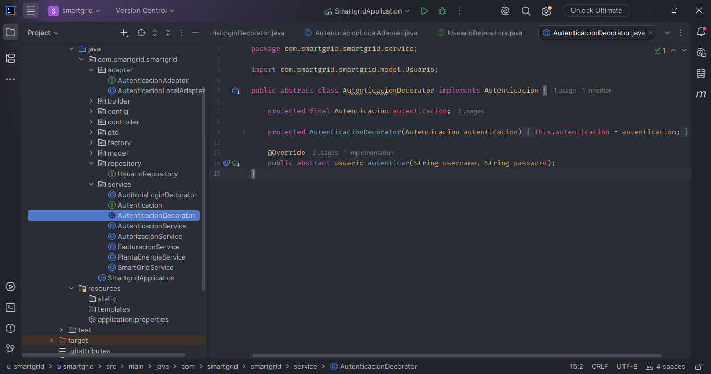

La implementación concreta es `AuditoriaLoginDecorator`. Esta clase recibe `AutenticacionLocalAdapter` y ejecuta primero el proceso normal de autenticación. Después de obtener el resultado, agrega la funcionalidad de auditoría registrando en consola si el inicio de sesión fue exitoso o fallido.

Por ejemplo, cuando el usuario `admin` inicia sesión correctamente, se registra:

`[AUDITORIA] Inicio de sesión exitoso: admin`

Si las credenciales son incorrectas, se registra:

`[AUDITORIA] Intento de inicio de sesión fallido: admin`

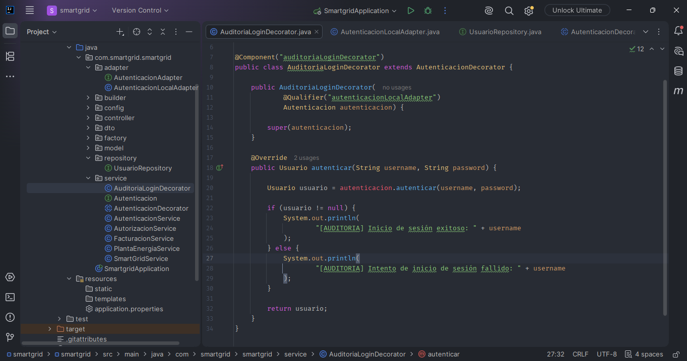


La principal ventaja de esta implementación es que la auditoría se agrega sin modificar `AutenticacionLocalAdapter`. El Decorator funciona como una capa adicional alrededor del proceso original.

El flujo queda organizado de la siguiente manera:

`AuthController → AutenticacionService → AuditoriaLoginDecorator → AutenticacionLocalAdapter → UsuarioRepository`

De esta manera, si posteriormente se necesita agregar otra responsabilidad al inicio de sesión, como registrar estadísticas o generar otro tipo de registro, se puede implementar mediante otro Decorator sin modificar la lógica original de autenticación.

### Diagrama UML Adapter y Decorator

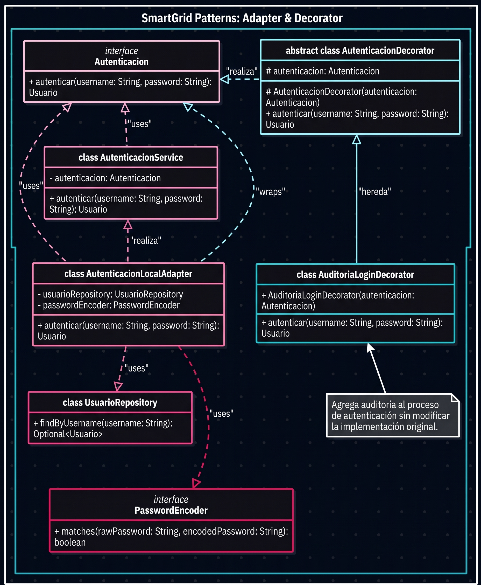

### Video Patrón Adapter y Decorator

[](https://www.youtube.com/watch?v=SI6Rr6OUCIs)

---


### Patrón Bridge

El patrón Bridge permite separar una abstracción de su implementación, permitiendo que ambas puedan evolucionar de manera independiente. Es especialmente útil cuando existen dos dimensiones de variación que pueden cambiar por separado y que generarían múltiples combinaciones de clases si permanecieran acopladas.

Después de analizar la arquitectura actual de Smart Grid, se decidió no implementar este patrón debido a que el sistema no presenta actualmente dos jerarquías independientes que necesiten evolucionar de forma separada.

Los componentes implementados, como la autenticación, las facturas, las plantas de energía y la configuración general del sistema, tienen responsabilidades concretas y no requieren separar una abstracción de diferentes implementaciones independientes.

Implementar Bridge en este punto implicaría agregar abstracciones, interfaces e implementaciones adicionales que no solucionarían un problema existente dentro del proyecto.

Por esta razón, se decidió no utilizar este patrón para evitar aumentar innecesariamente la complejidad de la arquitectura.

## Patrón Facade 

Se implementó el patrón de diseño estructural **Facade** para simplificar el acceso a las funcionalidades principales del sistema SmartGrid. Este patrón proporciona un punto de entrada unificado que coordina las operaciones de diferentes servicios del backend.

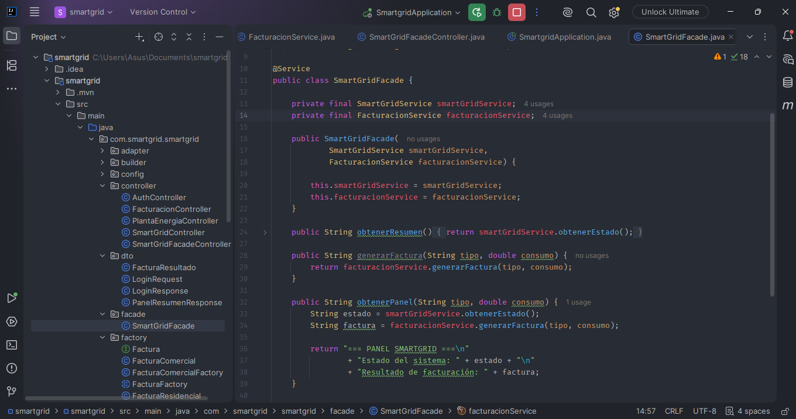

El frontend desarrollado en Angular realiza una petición HTTP al backend. El controlador recibe la solicitud y delega la operación a `SmartGridFacade`, que coordina las llamadas a los servicios correspondientes.

La fachada reúne los resultados y permite devolver una respuesta estructurada en formato JSON, que Angular utiliza para actualizar la información del panel sin recargar la página.

### Endpoints implementados

| Método HTTP | Endpoint                 | Función                                                                    |
| ----------- | ------------------------ | -------------------------------------------------------------------------- |
| GET         | `/api/facade/resumen`    | Consulta un resumen del sistema.                                           |
| GET         | `/api/facade/panel`      | Obtiene la información del panel en formato de texto.                      |
| GET         | `/api/facade/panel-json` | Devuelve el estado del sistema y los datos de facturación en formato JSON. |

El endpoint `/api/facade/panel-json` acepta los parámetros `tipo` y `consumo`. Si no se especifican, utiliza los valores predeterminados `RESIDENCIAL` y `350`, respectivamente.

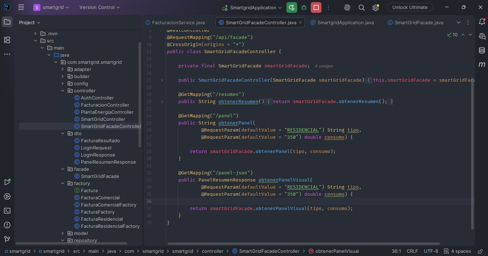

**Ejemplo de consulta:**

```http
GET http://localhost:8080/api/facade/panel-json?tipo=RESIDENCIAL&consumo=350
```

**Respuesta esperada:**

```json
{
  "estadoSistema": "SmartGrid está activo",
  "factura": {
    "tipoFactura": "RESIDENCIAL",
    "consumo": 350.0,
    "tarifa": 500.0,
    "total": 175000.0
  }
}
```

### Integración con Angular

Se desarrolló un panel de control que consume el endpoint `/api/facade/panel-json` mediante `HttpClient`.

La interfaz permite:

* Consultar el estado del sistema SmartGrid.
* Seleccionar facturación residencial o comercial.
* Ingresar el consumo energético en kWh.
* Visualizar la tarifa aplicada y el total de la factura.
* Actualizar los resultados sin recargar la página.

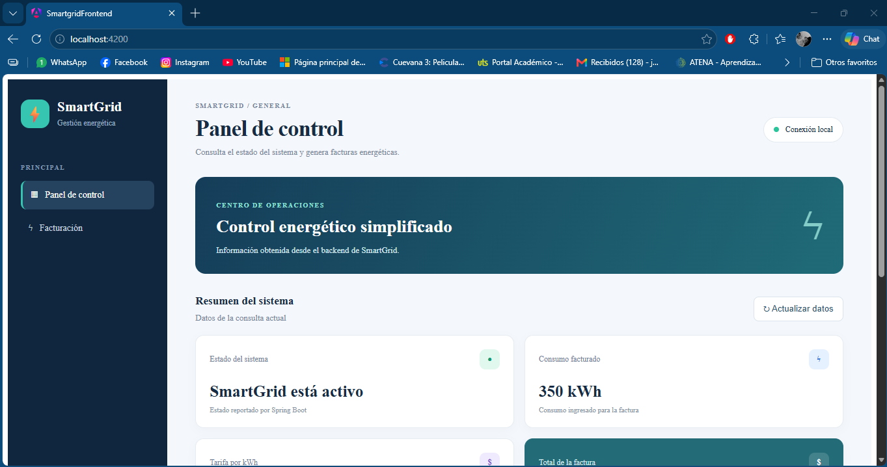

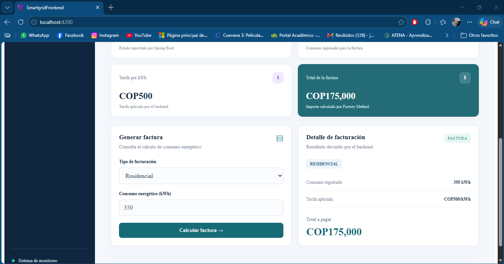

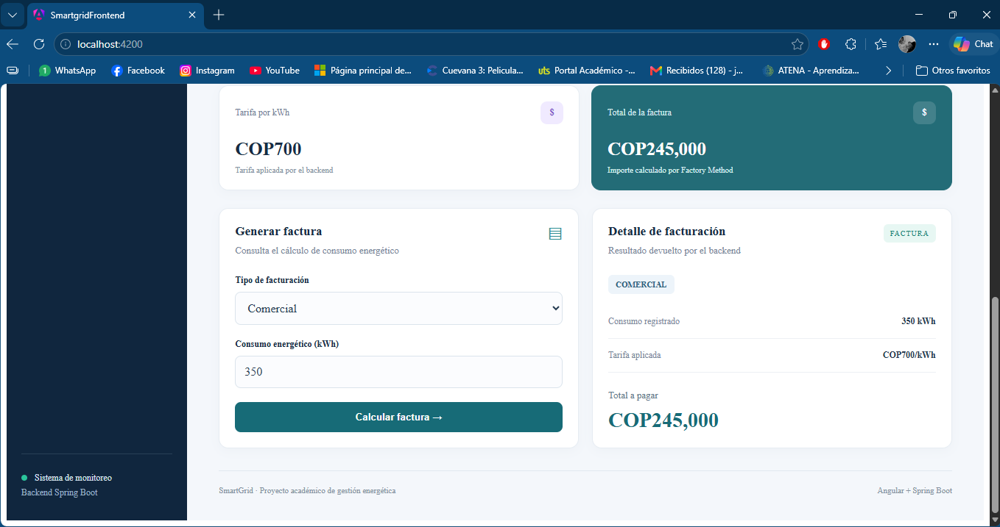

### Ventajas

* Simplifica la interacción entre el controlador y los servicios del backend.
* Centraliza la coordinación de las operaciones relacionadas con el panel.
* Reduce el acoplamiento entre los componentes.
* Facilita el mantenimiento y la integración con el frontend.
* Permite reutilizar los servicios sin duplicar su lógica de negocio.

### Diagrama UML Facade 

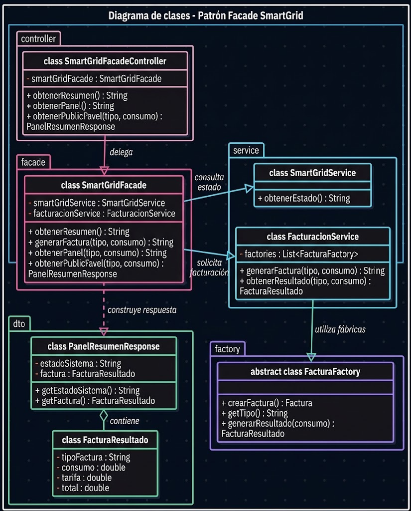

La implementación de Facade demuestra cómo una fachada puede ofrecer una interfaz simplificada para acceder a varias funcionalidades de un sistema, manteniendo separadas las responsabilidades de consulta del estado y cálculo de facturación.

### Video Patrón Facade

[](https://www.youtube.com/watch?v=WedsvCXpcdo)

---


## Patrón Flyweight

### Propósito

El patrón estructural Flyweight permite compartir objetos que contienen información común entre múltiples instancias, reduciendo la creación de objetos duplicados y el consumo de memoria.

### Implementación en SmartGrid

En SmartGrid, Flyweight se utiliza para compartir la información común de las fuentes de energía de las plantas. Por ejemplo, varias plantas solares pueden reutilizar el mismo objeto con la descripción y las características de la energía solar.

**Clases involucradas:**

- `FuenteEnergiaFlyweight`: almacena la información compartida de una fuente energética, incluyendo su tipo, descripción y características.
- `FuenteEnergiaFactory`: administra los objetos compartidos mediante un `HashMap` y reutiliza el objeto correspondiente al tipo de fuente solicitado.
- `PlantaEnergia`: integra Flyweight con el patrón Builder y mantiene una referencia al objeto compartido de su fuente energética.
- `FlyweightTest`: comprueba que dos plantas solares reutilizan la misma instancia de `FuenteEnergiaFlyweight`.

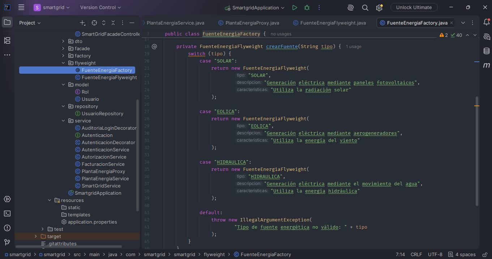

### Funcionamiento

Cuando se construye una planta, `PlantaEnergia` solicita a `FuenteEnergiaFactory` el objeto correspondiente a su fuente energética. Si ya existe, se reutiliza; de lo contrario, se crea y se almacena para futuras solicitudes.

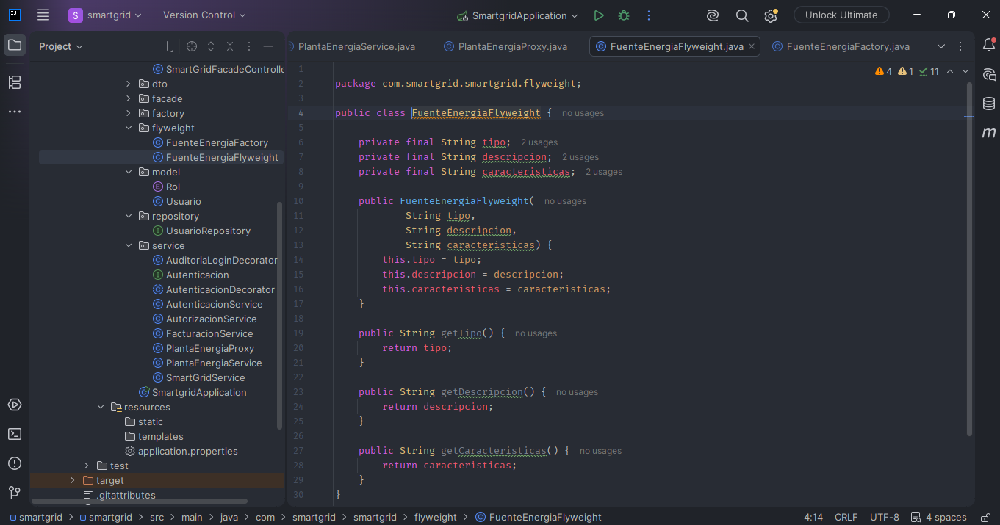

La comparación mediante `==` en la prueba automatizada permite verificar que dos plantas solares hacen referencia al mismo objeto en memoria.

### Prueba realizada

La prueba `FlyweightTest` finalizó correctamente con el resultado **Test passed**, confirmando la reutilización de la instancia para dos plantas solares.

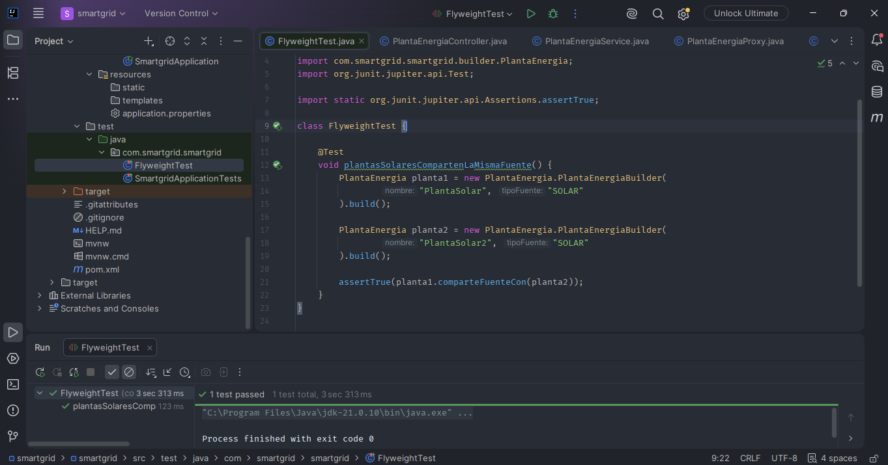

**Alcance actual:** las plantas se construyen en memoria y todavía no se persisten en la base de datos.

### Diagrama UML Flyweight

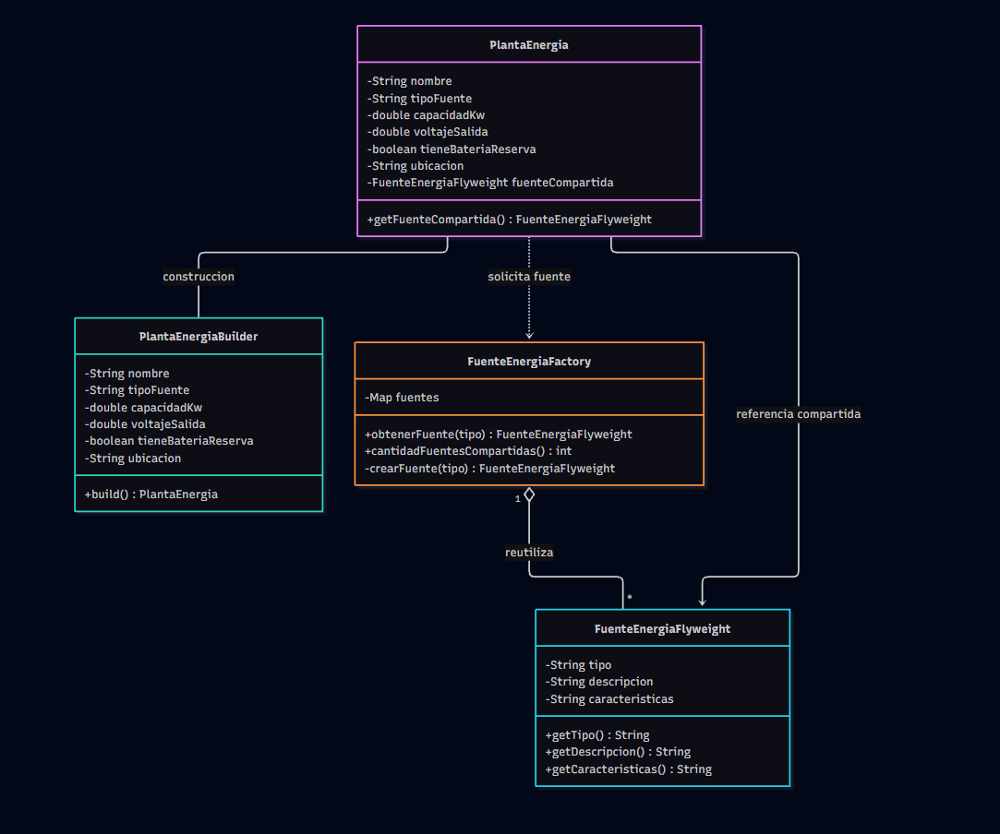

---

### Video patrón Flayweight

[](https://www.youtube.com/watch?v=15xdZdC2LHo)

---

## Patrón Proxy

### Propósito

El patrón estructural Proxy proporciona un intermediario que controla el acceso a un objeto o servicio real antes de delegarle una operación.

### Implementación en SmartGrid

En SmartGrid, Proxy controla el acceso a la construcción de plantas energéticas según el rol del usuario. Solamente los usuarios activos con el rol `ADMIN` pueden ejecutar esta operación.

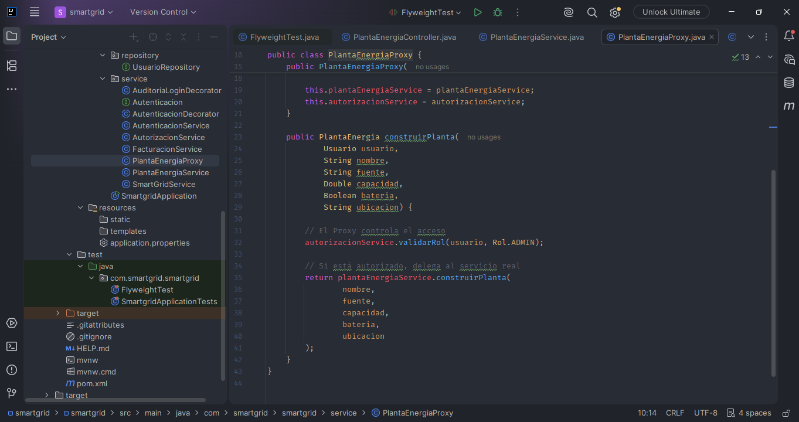

**Clases involucradas:**

- `PlantaEnergiaController`: recibe la solicitud HTTP y busca al usuario en la base de datos mediante `UsuarioRepository`.
- `PlantaEnergiaProxy`: actúa como intermediario, valida los permisos del usuario y delega la operación al servicio real.
- `AutorizacionService`: comprueba que el usuario esté activo y tenga el rol requerido. Si no cumple las condiciones, genera una respuesta HTTP `403 Forbidden`.
- `PlantaEnergiaService`: construye la planta utilizando el patrón Builder.


### Funcionamiento

1. El controlador recibe la solicitud para construir una planta.
2. Se busca el usuario por su nombre de usuario.
3. El controlador entrega el usuario y los datos de la planta a `PlantaEnergiaProxy`.
4. El Proxy solicita a `AutorizacionService` la validación del rol `ADMIN`.
5. Si el usuario está autorizado, el Proxy delega la construcción a `PlantaEnergiaService`.
6. Si el usuario no está autorizado o está inactivo, la operación se rechaza con HTTP `403 Forbidden`.

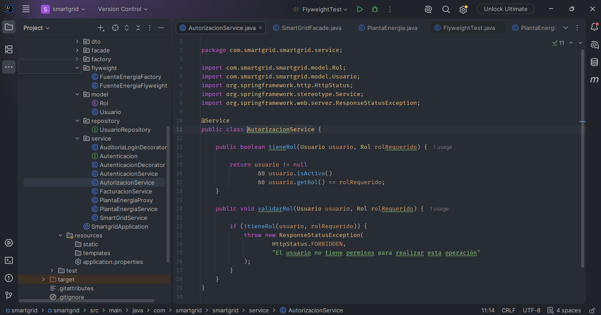

### Pruebas realizadas

| Usuario | Resultado | Descripción |
|---|---|---|
| `admin` | HTTP 200 OK | Se permite construir la planta. |
| `operador` | HTTP 403 Forbidden | Se rechaza la operación por falta de autorización. |

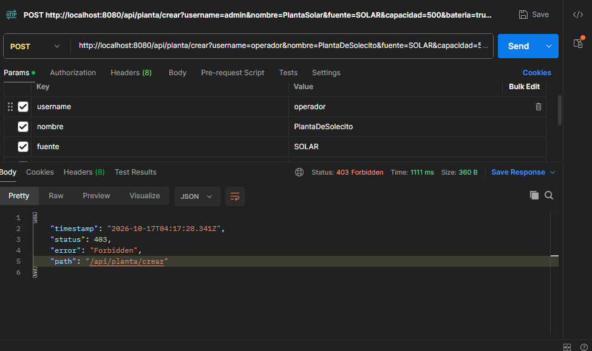

**Alcance actual:** Proxy controla el acceso a la construcción de plantas, pero estas todavía no se guardan en PostgreSQL. La autorización se basa en el usuario y su rol recuperados de la base de datos; no representa por sí sola un sistema completo de autenticación y seguridad HTTP.

### Diagrama UML Proxy

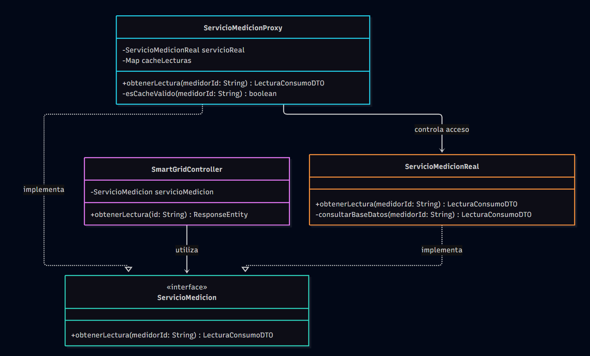

---

### Video patrón Proxy

[](https://www.youtube.com/watch?v=dnaba2vTqcw)

---

## Patrón Chain of Responsibility 

### ¿Qué es?

El patrón Chain of Responsibility permite pasar una solicitud a través de una cadena de objetos encargados de procesarla. Cada objeto realiza una validación o acción y, si corresponde, delega la solicitud al siguiente elemento de la cadena.

### Implementación en SmartGrid

En SmartGrid se utiliza este patrón para validar los datos necesarios antes de construir una planta de energía. De esta manera, cada validación se encuentra separada en una clase independiente, facilitando el mantenimiento y la incorporación de nuevas reglas.

### Clases involucradas

- **ValidacionHandler:** clase abstracta que define la estructura general de los validadores. Contiene la referencia al siguiente elemento de la cadena y el método para ejecutar las validaciones.

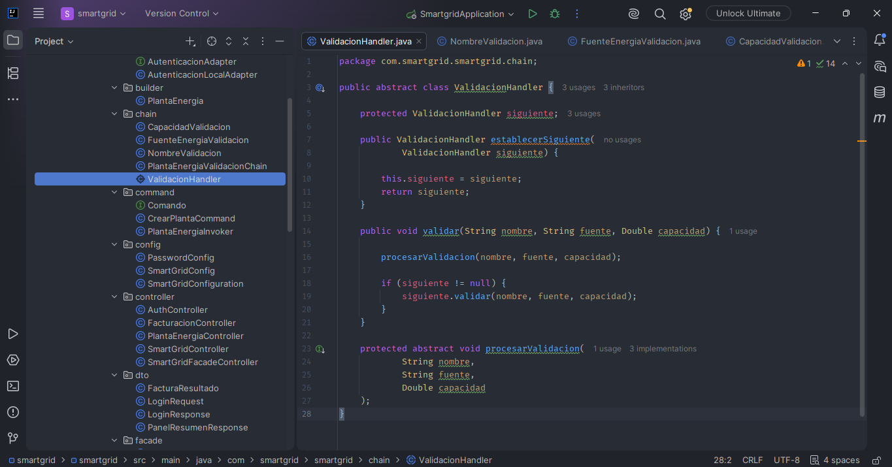

- **NombreValidacion:** verifica que el nombre de la planta no sea nulo ni esté vacío.

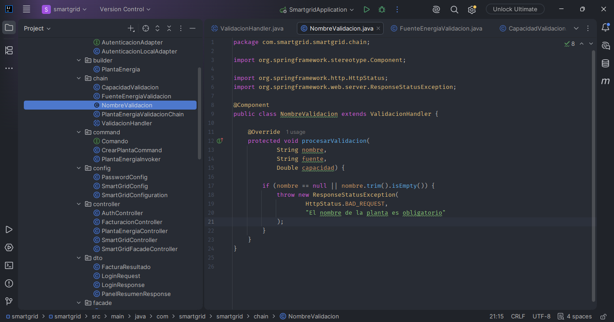
  
- **FuenteEnergiaValidacion:** comprueba que el tipo de fuente de energía sea válido: SOLAR, EOLICA o HIDRAULICA.

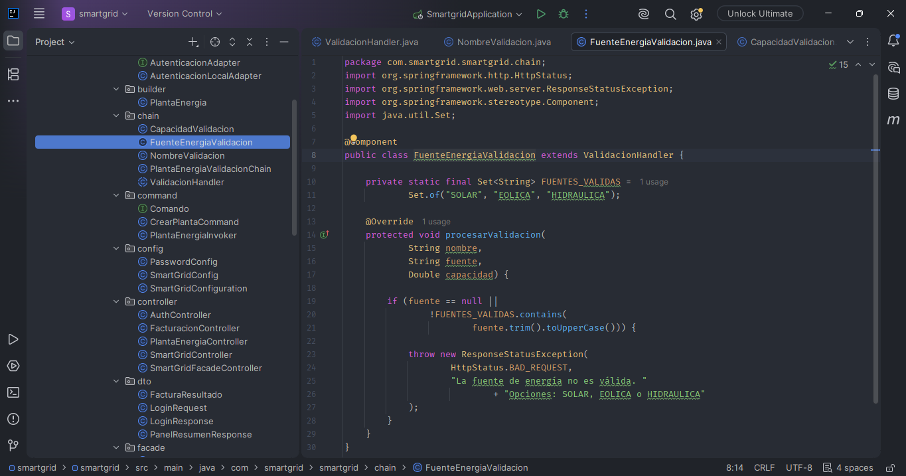

- **CapacidadValidacion:** verifica que la capacidad de generación, cuando se proporciona, sea mayor que cero.

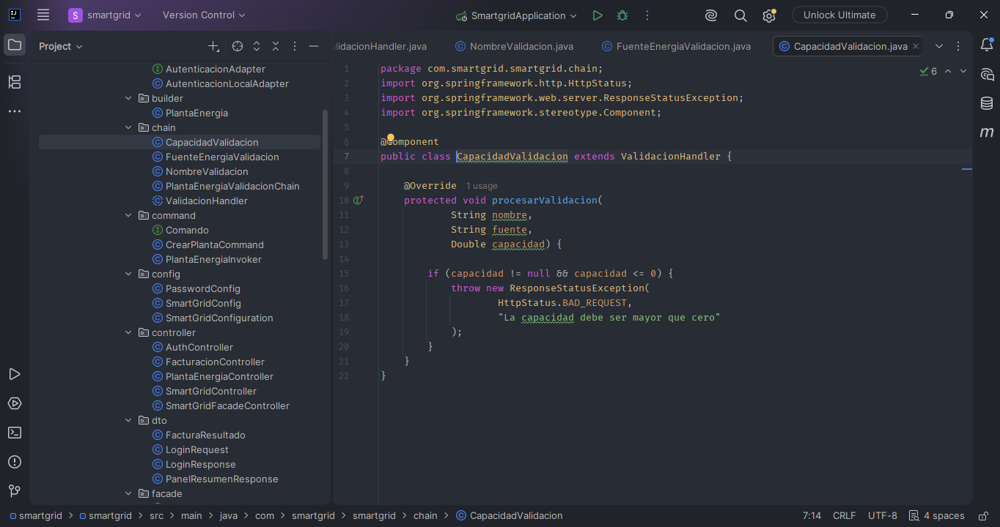

- **PlantaEnergiaValidacionChain:** configura y organiza la cadena de validaciones, estableciendo el orden en que deben ejecutarse.

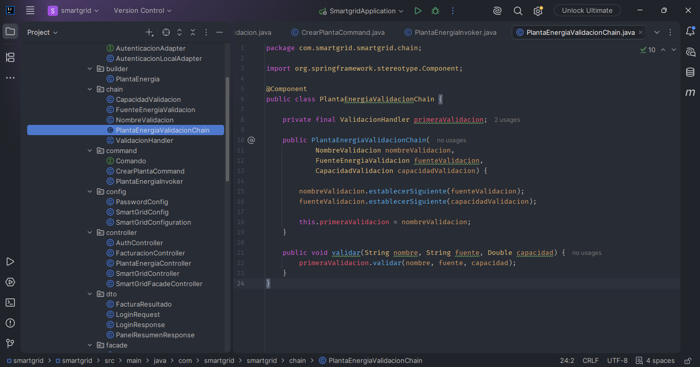

### Funcionamiento

Cuando se solicita construir una planta de energía, el sistema ejecuta las validaciones en el siguiente orden:

1. **Validación del nombre:** comprueba que se haya proporcionado un nombre.
2. **Validación de la fuente:** verifica que la fuente de energía corresponda a una de las opciones permitidas.
3. **Validación de la capacidad:** comprueba que la capacidad sea mayor que cero, si se especificó.

Si alguna validación falla, se genera una excepción HTTP 400 (Bad Request) y se detiene el proceso. Si todas las validaciones son correctas, se permite continuar con la construcción de la planta.

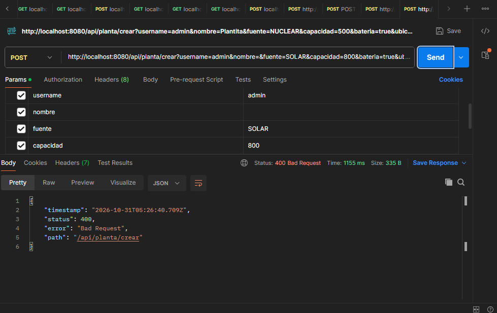

### Ventajas de su implementación

- Separa las reglas de validación en clases independientes.
- Facilita agregar nuevas validaciones sin modificar las existentes.
- Permite organizar el proceso de validación en una secuencia.
- Mejora la organización y el mantenimiento del código.

---

### Diagrama UML Chain of Responsibility

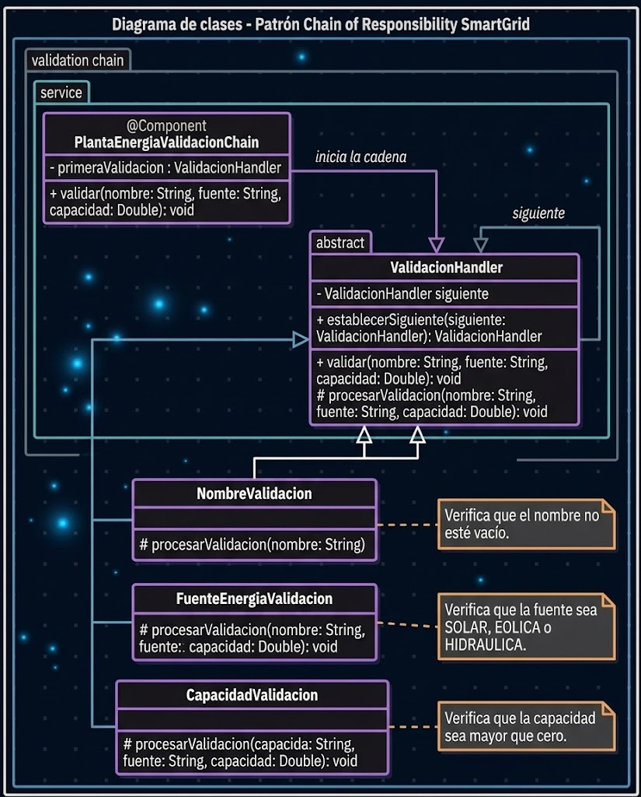

---

## Patrón Command 

### ¿Qué es?

El patrón Command encapsula una solicitud u operación dentro de un objeto. Esto permite separar el objeto que solicita una acción del objeto que realmente la ejecuta.

### Implementación en SmartGrid

En SmartGrid se utiliza este patrón para encapsular la operación de construcción de una planta de energía. Los parámetros necesarios se almacenan dentro de un comando y posteriormente se ejecuta la operación mediante un objeto encargado de invocarlo.

### Clases involucradas

- **Comando:** interfaz que define el método `ejecutar()`, el cual deben implementar los comandos concretos.

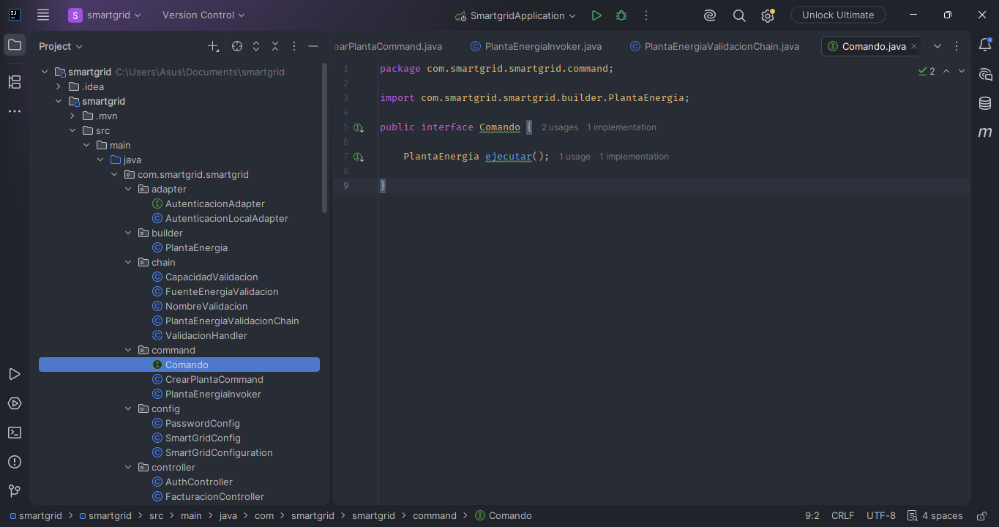

- **CrearPlantaCommand:** implementación concreta que almacena los datos de la planta y delega su construcción a `PlantaEnergiaService`.

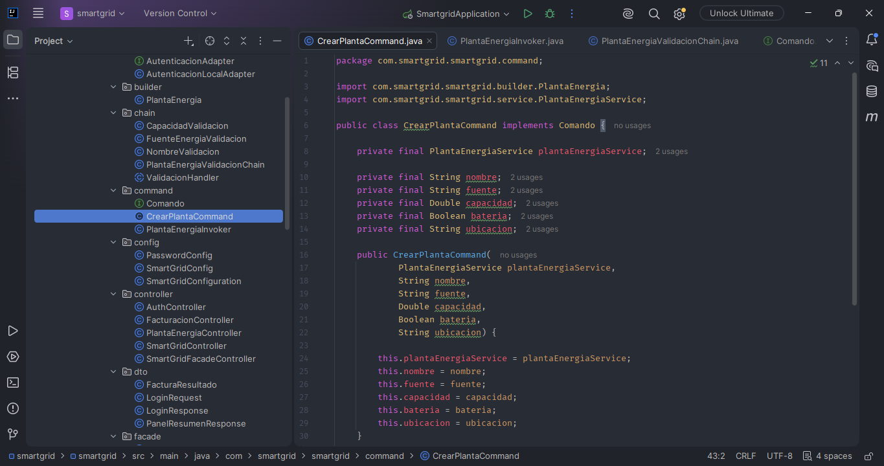
  
- **PlantaEnergiaInvoker:** encargado de recibir el comando y solicitar su ejecución, sin conocer los detalles internos de la operación.

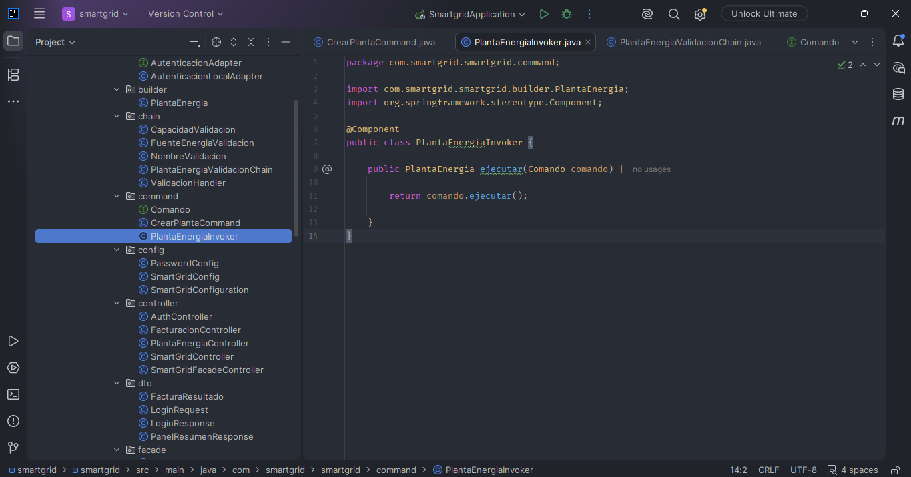

- **PlantaEnergiaService:** contiene la lógica para construir una planta de energía utilizando el patrón Builder.

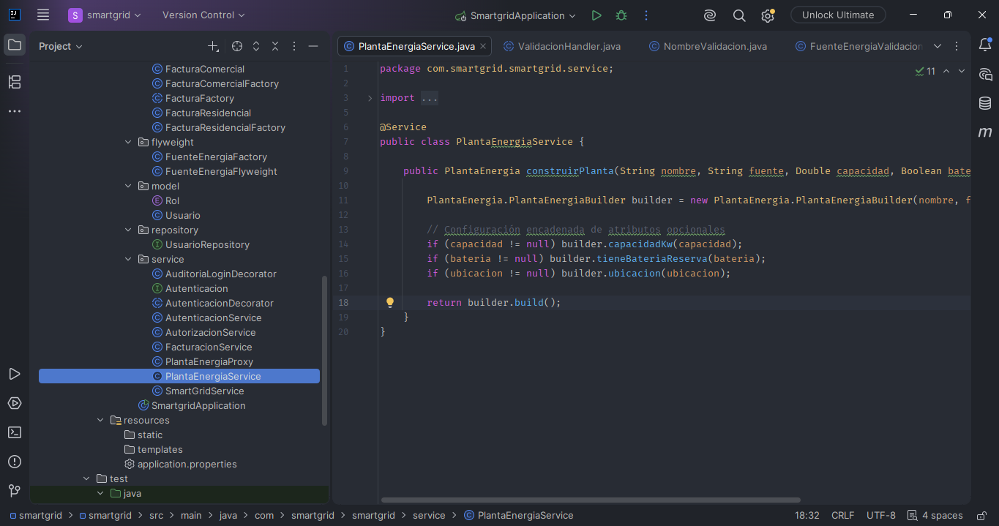

- **PlantaEnergia:** objeto resultante de la construcción de la planta.

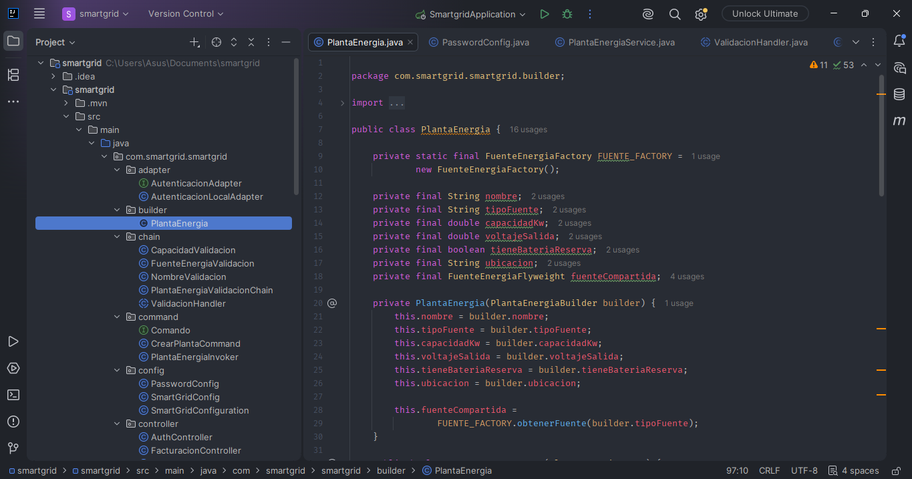

### Funcionamiento

El proceso de ejecución se desarrolla de la siguiente manera:

1. El sistema recibe una solicitud para construir una planta de energía.
2. Se crea un objeto `CrearPlantaCommand` con los parámetros necesarios: nombre, fuente, capacidad, batería de reserva y ubicación.
3. El comando recibe una instancia de `PlantaEnergiaService`.
4. `PlantaEnergiaInvoker` recibe el comando y ejecuta su método `ejecutar()`.
5. `CrearPlantaCommand` delega la construcción a `PlantaEnergiaService`.
6. El servicio utiliza el patrón Builder para construir y devolver el objeto `PlantaEnergia`.

### Ventajas de su implementación

- Separa la solicitud de la ejecución de una operación.
- Encapsula los parámetros y la lógica de una acción en un objeto.
- Facilita incorporar nuevos comandos para otras operaciones.
- Permite que el invocador ejecute comandos sin conocer su implementación interna.
- Favorece la organización y reutilización del código.

En esta implementación, Command trabaja junto con Builder: Command encapsula la solicitud y Builder se encarga de construir el objeto paso a paso.

---

### Diagrama UML Command

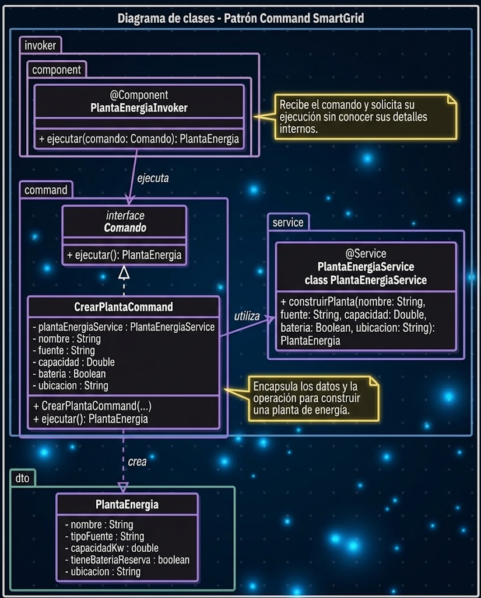

---

### Video patrones Chain of responsability & Command

[](https://www.youtube.com/watch?v=b75lsYrQZok)

---

## Patrones incorporados durante la evolución del proyecto

Durante la primera etapa de desarrollo se decidió no implementar algunos patrones porque el sistema todavía no presentaba necesidades funcionales que justificaran su utilización. En ese momento, la arquitectura era más sencilla y las operaciones podían resolverse mediante los servicios, controladores y patrones que ya estaban implementados.

Sin embargo, a medida que SmartGrid evolucionó y se incorporaron funcionalidades de consumo energético, jerarquías de zonas, supervisión de capacidad, operación de plantas, balanceo de cargas y diferentes modalidades de facturación, surgieron nuevas necesidades de organización y comportamiento.

Por esta razón, se revisó la decisión inicial y se incorporaron cinco patrones adicionales: *Composite, Observer, State, Strategy y Template Method*.

### 9. Composite — Patrón estructural

*¿Qué es?*

El patrón Composite permite organizar objetos en estructuras jerárquicas, tratando de la misma manera tanto los elementos individuales como los grupos que contienen otros elementos.

*Propósito:* representar estructuras jerárquicas mediante una interfaz común, permitiendo realizar operaciones sobre elementos individuales y compuestos sin diferenciarlos desde el código que los utiliza.

*Aplicación en SmartGrid:*

Se utiliza para representar la estructura jerárquica de las zonas de la red eléctrica. Una zona puede ser un elemento individual o contener otras zonas.

El patrón permite consultar el consumo de una zona individual o calcular el consumo acumulado de una zona compuesta por otras zonas, utilizando una misma interfaz.

*Clases principales:*

- ComponenteRed: define la interfaz común para los elementos de la estructura.
- ZonaRedNodo: contiene los datos y comportamientos compartidos por los nodos.
- ZonaHoja: representa una zona que no contiene otras zonas.
- ZonaCompuesta: representa una zona que puede contener otros componentes y agregar sus consumos.

*¿Por qué no se implementó inicialmente y por qué ahora sí?*

En la primera etapa del proyecto, las zonas de SmartGrid se manejaban como registros independientes. No existía una jerarquía funcional que necesitara representar zonas principales con otras zonas en su interior. Por esta razón, implementar Composite habría agregado clases y relaciones innecesarias para las funcionalidades disponibles en ese momento.

Posteriormente, al ampliar el módulo de red y consumo energético, surgió la necesidad de representar zonas jerárquicas y consultar el consumo acumulado de sus componentes. Esto justificó la incorporación de Composite, ya que permite tratar de manera uniforme las zonas individuales y las compuestas, facilitando la extensión de la estructura de la red.

---

### 12. Observer — Patrón de comportamiento

*¿Qué es?*

El patrón Observer establece una relación de uno a muchos entre objetos. Cuando un objeto cambia o genera un evento, los objetos que están suscritos reciben una notificación y pueden ejecutar sus propias acciones.

*Propósito:* notificar automáticamente a diferentes componentes cuando ocurre un evento, evitando que el objeto que genera dicho evento tenga que conocer directamente todas las acciones que deben ejecutarse.

*Aplicación en SmartGrid:*

Se utiliza en el registro de lecturas de consumo energético. Cuando se registra una nueva lectura, el sujeto observado notifica a los observadores registrados.

Uno de estos observadores es AlertaCapacidadObserver, encargado de evaluar el consumo reciente de una zona y generar alertas cuando se alcanzan o superan determinados umbrales de capacidad.

De esta manera, el registro de una lectura puede activar automáticamente la supervisión de la capacidad sin mezclar ambas responsabilidades en un mismo servicio.

*Clases principales:*

- LecturaObserver: define el contrato que deben implementar los observadores.
- LecturaConsumoSubject: administra los observadores y realiza las notificaciones.
- AlertaCapacidadObserver: evalúa el consumo reciente y registra alertas cuando se cumplen las condiciones establecidas.
- LecturaService: integra el registro de lecturas con el proceso de notificación.

*¿Por qué no se implementó inicialmente y por qué ahora sí?*

En la primera etapa, el backend trabajaba principalmente mediante operaciones REST síncronas: el usuario realizaba una solicitud y el sistema devolvía una respuesta. No existía un evento que necesitara notificar a varios componentes independientes, por lo que Observer no ofrecía una ventaja significativa.

Posteriormente, al incorporar el registro de lecturas y la supervisión de la capacidad de las zonas, apareció la necesidad de ejecutar acciones automáticas después de guardar una lectura. Por esta razón se incorporó Observer, permitiendo separar el evento de registro de consumo de las acciones que reaccionan a él.

Esto también facilita agregar nuevos observadores en el futuro sin modificar directamente el componente encargado de registrar las lecturas.

---

### 13. State — Patrón de comportamiento

*¿Qué es?*

El patrón State permite que un objeto modifique su comportamiento dependiendo de su estado interno. Cada estado se representa mediante una clase independiente que contiene las reglas correspondientes.

*Propósito:* organizar los comportamientos asociados a los diferentes estados de un objeto, evitando concentrar todas las condiciones y transiciones en una sola clase.

*Aplicación en SmartGrid:*

Se utiliza para administrar el ciclo de vida operativo de las plantas de generación eléctrica.

Una planta puede encontrarse en diferentes estados:

- *ACTIVA:* la planta puede operar y generar energía.
- *MANTENIMIENTO:* la planta se encuentra en mantenimiento y no debe generar energía.
- *FUERA_DE_SERVICIO:* la planta no está disponible para operar.

Cada estado define su comportamiento y las transiciones permitidas hacia otros estados. De esta manera, el sistema puede controlar los cambios de estado y determinar si una planta está habilitada para generar energía.

*Clases principales:*

- EstadoPlantaState: define el contrato común de los estados.
- EstadoPlantaResolver: identifica y obtiene el comportamiento correspondiente al estado actual.
- ActivaState: representa el comportamiento de una planta activa.
- MantenimientoState: representa el comportamiento de una planta en mantenimiento.
- FueraDeServicioState: representa el comportamiento de una planta fuera de servicio.

*¿Por qué no se implementó inicialmente y por qué ahora sí?*

En la primera etapa del proyecto, los estados de las entidades eran atributos sencillos que podían manejarse mediante validaciones y condiciones dentro de los servicios. No existían suficientes comportamientos diferentes asociados a cada estado para justificar la creación de clases especializadas.

Posteriormente, con el desarrollo de las funcionalidades de operación de plantas, los estados comenzaron a determinar reglas importantes del sistema, como permitir o impedir la generación de energía y controlar qué cambios de estado eran válidos.

Esto justificó la incorporación de State, ya que permite encapsular las reglas de cada estado y mantener organizado el ciclo de vida de las plantas, evitando que las condiciones crezcan y se dispersen por diferentes servicios.

---

### 14. Strategy — Patrón de comportamiento

*¿Qué es?*

El patrón Strategy permite definir diferentes algoritmos o comportamientos mediante una interfaz común, de manera que puedan seleccionarse e intercambiarse según las necesidades del sistema.

*Propósito:* separar los algoritmos de la lógica que los utiliza, facilitando la incorporación de nuevas estrategias sin modificar directamente los servicios principales.

*Aplicación en SmartGrid:*

Se utiliza en tres funcionalidades principales del sistema:

*1. Estrategias de producción energética*

Permiten seleccionar el cálculo de producción correspondiente según la fuente de energía utilizada por la planta.

- SolarProduccionStrategy: calcula la producción para plantas solares.
- EolicaProduccionStrategy: calcula la producción para plantas eólicas.
- HidraulicaProduccionStrategy: calcula la producción para plantas hidráulicas.

*2. Estrategias de balanceo de cargas*

Permiten seleccionar diferentes criterios para distribuir o reducir la demanda energética.

- MayorDeficitBalanceoStrategy: prioriza las zonas que presentan un mayor déficit energético.
- ProporcionalBalanceoStrategy: distribuye las acciones de balanceo de manera proporcional.

*3. Estrategias de facturación*

Permiten seleccionar diferentes modalidades de cálculo de tarifas.

- PlanaTarifaStrategy: utiliza una tarifa plana.
- EscalonadaTarifaStrategy: aplica tarifas según los niveles de consumo.
- HorariaTarifaStrategy: considera las franjas horarias para calcular el costo.

*Clases principales:*

- Producción: ProduccionStrategy, SolarProduccionStrategy, EolicaProduccionStrategy, HidraulicaProduccionStrategy y ProduccionStrategyRegistry.
- Balanceo: BalanceoStrategy, MayorDeficitBalanceoStrategy, ProporcionalBalanceoStrategy y BalanceoStrategyRegistry.
- Tarifas: TarifaStrategy, PlanaTarifaStrategy, EscalonadaTarifaStrategy, HorariaTarifaStrategy y TarifaStrategyRegistry.

*¿Por qué no se implementó inicialmente y por qué ahora sí?*

En la primera etapa, las funcionalidades del sistema eran más limitadas y no existían varias familias de algoritmos que necesitaran intercambiarse de manera independiente. Los cálculos y operaciones disponibles podían resolverse mediante las implementaciones existentes, sin necesidad de introducir diferentes estrategias.

Posteriormente, al ampliar el sistema con diferentes fuentes de generación energética, criterios de balanceo de cargas y modalidades tarifarias, surgió la necesidad de separar los algoritmos y seleccionar el comportamiento adecuado según cada operación.

Esto justificó la incorporación de Strategy, ya que permite agregar o modificar algoritmos sin concentrar todas las fórmulas en un único servicio ni aumentar la cantidad de condicionales según el tipo de operación.

---

### 15. Template Method — Patrón de comportamiento

*¿Qué es?*

El patrón Template Method define la estructura general de un algoritmo en una clase base, permitiendo que las clases derivadas implementen o especialicen determinados pasos sin modificar el orden general del proceso.

*Propósito:* reutilizar una secuencia de operaciones comunes y permitir que ciertos pasos varíen según la necesidad de cada implementación.

*Aplicación en SmartGrid:*

Se utiliza en el módulo de facturación para mantener un flujo común de generación de facturas, aunque el consumo energético pueda obtenerse de diferentes maneras.

El proceso conserva una secuencia general de operaciones, como validar el cliente y el período, obtener el consumo, seleccionar la tarifa, calcular los importes y guardar la factura cuando corresponde.

La diferencia entre las modalidades se encuentra principalmente en la forma de obtener el consumo:

- *Facturación por lecturas:* obtiene el consumo a partir de las lecturas energéticas registradas.
- *Facturación estimada:* calcula una estimación utilizando el promedio de las últimas tres facturas no anuladas.

*Clases principales:*

- PlantillaFacturacion: define el flujo general mediante el método ejecutar().
- FacturacionPorLecturas: implementa la obtención del consumo mediante las lecturas registradas.
- FacturacionEstimada: implementa la obtención del consumo mediante una estimación basada en facturas anteriores.
- PlantillaFacturacionRegistry: selecciona la plantilla de facturación correspondiente al modo solicitado.

*¿Por qué no se implementó inicialmente y por qué ahora sí?*

En la primera etapa, el proceso de facturación era más sencillo y no existían diferentes modalidades que compartieran una secuencia de operaciones. Por esta razón, implementar una clase base con pasos especializados habría agregado complejidad sin aportar una ventaja funcional clara.

Posteriormente, al incorporar la facturación basada en lecturas reales y la facturación estimada, surgió la necesidad de mantener un mismo procedimiento general, pero permitiendo que la obtención del consumo cambiara según la modalidad seleccionada.

Esto justificó la incorporación de Template Method, ya que permite reutilizar el flujo común de facturación y especializar únicamente los pasos que necesitan comportamientos diferentes, evitando duplicar la lógica compartida entre las modalidades.

---

### Justificación general de la evolución de los patrones

La incorporación de estos cinco patrones no representa una contradicción con las decisiones iniciales del proyecto. En la primera etapa, se evaluaron las necesidades existentes y se decidió no agregar estructuras que todavía no tenían una aplicación funcional clara.

A medida que SmartGrid creció, aparecieron nuevos requerimientos que hicieron necesario revisar esas decisiones. Por ejemplo, la administración de zonas jerárquicas justificó Composite; la supervisión automática del consumo justificó Observer; la administración de los estados operativos de las plantas justificó State; la variedad de algoritmos de producción, balanceo y tarifas justificó Strategy; y las diferentes modalidades de facturación justificaron Template Method.

Por lo tanto, la arquitectura evolucionó de acuerdo con las necesidades reales del sistema. La finalidad no fue implementar todos los patrones disponibles, sino seleccionar aquellos que aportaran una solución concreta, mejoraran la separación de responsabilidades y facilitaran el mantenimiento y la ampliación de SmartGrid.

---

## Patrón Iterator

### ¿Qué es?

El patrón Iterator permite recorrer los elementos de una colección de manera secuencial sin exponer directamente su estructura interna. Proporciona una forma estandarizada de acceder a los elementos, independientemente de cómo estén almacenados.

### Evaluación en SmartGrid

En SmartGrid, el manejo y recorrido de colecciones, como listas de plantas de energía o registros de consumo, puede realizarse mediante las herramientas que proporciona Java, como las interfaces `Iterator` e `Iterable`, los ciclos mejorados (*for-each*) y la API de Streams.

Asimismo, la comunicación entre el backend y el frontend se realiza mediante servicios REST que exponen los datos en formato JSON, permitiendo que Angular los procese mediante arreglos y sus mecanismos habituales de iteración.

### Razones para no implementarlo

Se decidió no implementar una versión personalizada del patrón Iterator por las siguientes razones:

- Java proporciona mecanismos nativos para recorrer colecciones.
- No existe la necesidad de ocultar estructuras de datos mediante iteradores personalizados.
- Una implementación adicional generaría clases e interfaces innecesarias.
- Las herramientas actuales permiten realizar los recorridos requeridos de manera sencilla y eficiente.

Por esto se determinó que la implementación personalizada de Iterator no aportaría un beneficio significativo a la arquitectura actual de SmartGrid, debido a que las necesidades de recorrido de colecciones ya están cubiertas por las funcionalidades estándar del lenguaje Java.


---


## Patrón Memento

### ¿Qué es?

El patrón Memento permite capturar y almacenar el estado interno de un objeto para restaurarlo posteriormente sin exponer directamente su estructura interna. Se utiliza principalmente para implementar funcionalidades de recuperación de estados anteriores, como los mecanismos de deshacer y rehacer (*undo/redo*).

### Evaluación en SmartGrid

En SmartGrid, actualmente no se contempla la necesidad de implementar funcionalidades de restauración de estados anteriores sobre los objetos del sistema.

Las operaciones de consulta y modificación de información se gestionan mediante los servicios del backend y la persistencia de los datos en PostgreSQL.

Aunque sería posible implementar Memento utilizando almacenamiento persistente, esto implicaría desarrollar mecanismos adicionales para capturar, conservar y recuperar estados anteriores, sin responder a una necesidad funcional actual del proyecto.

### Razones para no implementarlo

Se decidió no implementar este patrón por las siguientes razones:

- Actualmente no existen funcionalidades que requieran deshacer o restaurar operaciones.
- La información del sistema se gestiona mediante los servicios y la base de datos PostgreSQL.
- La conservación de registros históricos puede resolverse mediante mecanismos de persistencia y auditoría cuando exista ese requerimiento.
- Su implementación aumentaría la complejidad de la arquitectura sin aportar un beneficio significativo a las funcionalidades actuales.

Por estas razones se determinó que Memento no es necesario para la versión actual de SmartGrid, debido a que el sistema no requiere mecanismos de restauración de estados anteriores. Su incorporación podría evaluarse en futuras versiones si se implementan funcionalidades de recuperación de configuraciones o deshacer operaciones.

---


## Patrón Mediator

### ¿Qué es?

El patrón Mediator define un objeto central encargado de coordinar la comunicación y las interacciones entre diferentes componentes. Su objetivo es reducir las dependencias directas entre ellos y centralizar la lógica de coordinación.

### Evaluación en SmartGrid

En SmartGrid, la coordinación de operaciones que requieren integrar diferentes funcionalidades ya se encuentra organizada mediante el patrón Facade, que proporciona un punto de acceso simplificado a los servicios del sistema.

Asimismo, las operaciones relacionadas con la creación de plantas de energía están estructuradas mediante Chain of Responsibility y Command, asignando responsabilidades específicas a cada componente.

Spring Boot también facilita el desacoplamiento entre componentes mediante la inyección de dependencias. Sin embargo, este mecanismo no sustituye directamente la función de Mediator, ya que su propósito principal es administrar las dependencias y no centralizar la comunicación entre objetos.

En la arquitectura actual no existe una necesidad de coordinación compleja entre múltiples componentes que justifique incorporar un mediador adicional.

### Razones para no implementarlo

Se decidió no implementar este patrón por las siguientes razones:

- La coordinación de funcionalidades que requieren una interfaz simplificada ya está cubierta mediante Facade.
- Las operaciones de creación de plantas cuentan con responsabilidades distribuidas entre Chain of Responsibility y Command.
- Spring Boot permite gestionar las dependencias entre componentes mediante inyección de dependencias.
- No existe actualmente una comunicación compleja entre múltiples componentes que requiera un coordinador central adicional.
- Su incorporación podría generar una capa de intermediación innecesaria.

entonces se determinó que Mediator no es necesario para la arquitectura actual de SmartGrid, debido a que los mecanismos existentes permiten organizar y coordinar las operaciones del sistema. Su implementación se podría considerar en futuras versiones si aumenta la complejidad de las interacciones entre los diferentes subsistemas.

---


## Patrón Visitor

### ¿Qué es?

El patrón Visitor permite separar un algoritmo de la estructura de objetos sobre la que opera, facilitando agregar nuevas operaciones sin modificar las clases de los elementos visitados mediante despacho doble.

### Evaluación en SmartGrid

El modelo de dominio de SmartGrid es plano y está compuesto por entidades independientes en lugar de estructuras jerárquicas complejas como árboles o grafos heterogéneos.

Además, la principal línea de crecimiento del proyecto consiste en agregar nuevos tipos de facturas o nuevas fuentes de energía renovable, escenario que Factory Method y Builder resuelven sin modificar los servicios existentes, mientras que Visitor penaliza precisamente la incorporación de nuevos tipos de elementos.

### Razones para no implementarlo

Se decidió no implementar este patrón por las siguientes razones:

- El dominio no maneja estructuras compuestas o árboles de objetos heterogéneos que requieran recorridos especializados.
- El sistema necesita facilitar la adición de nuevos tipos de elementos, justo el punto débil del patrón Visitor.
- Implementar despacho doble en Java añade complejidad sintáctica innecesaria para operaciones directas.
- Las consultas y cálculos actuales se resuelven de forma clara en los servicios y entidades correspondientes.

Conservar las operaciones dentro de las propias entidades y servicios mantiene el código legible y preparado para sumar nuevos tipos de generación o facturación sin romper contratos previos. Si el sistema evolucionara hacia un simulador topológico de nodos eléctricos anidados sobre los cuales haya que ejecutar múltiples análisis externos —como flujo de carga, pérdidas térmicas o auditorías normativas—, Visitor sería un candidato adecuado.

---

## Instalación y ejecución del proyecto

### 1. Requisitos previos

Antes de ejecutar SmartGrid, asegúrate de tener instalados:

- **Java JDK 21**.
- **PostgreSQL**.
- **Node.js y npm** compatibles con Angular 20.
- **IntelliJ IDEA** o un editor compatible.
- Git (si se va a clonar el repositorio).

El proyecto incluye Maven Wrapper, por lo que no es necesario instalar Maven manualmente.

### 2. Descargar el repositorio

Clonar el repositorio desde una terminal:

```bash
git clone https://github.com/juandpl18/Proyecto_Patrones.git
cd Proyecto_Patrones
```

También puedes descargarlo desde GitHub mediante **Code → Download ZIP** y extraerlo en tu equipo.

La estructura principal es:

```text
Proyecto_Patrones/
├── smartgrid/
│   └── smartgrid/          # Backend Spring Boot
└── smartgrid-frontend/     # Frontend Angular
```

### 3. Configurar PostgreSQL

Inicia PostgreSQL y crea una base de datos llamada `smartgrid`:

```sql
CREATE DATABASE smartgrid;
```

**Importante:** el backend utiliza Flyway para administrar la estructura de la base de datos. Al iniciar la aplicación, las migraciones SQL se ejecutan automáticamente.

No es necesario importar manualmente un archivo SQL para una instalación nueva.

Si ya tienes una base de datos con información del proyecto, no la elimines ni la recrees. Conserva los datos existentes y realiza una copia de seguridad antes de efectuar cambios.

### 4. Configurar las variables de entorno del backend

El backend utiliza variables de entorno para configurar la conexión con PostgreSQL y la seguridad JWT.

En Windows PowerShell, ejecuta:

```powershell
$env:DB_URL="jdbc:postgresql://localhost:5432/smartgrid"
$env:DB_USER="postgres"
$env:DB_PASSWORD="TU_CLAVE_POSTGRES"
$env:JWT_SECRET="REEMPLAZA_POR_UN_SECRETO_PRIVADO_DE_AL_MENOS_32_BYTES"
```

En Linux o macOS:

```bash
export DB_URL="jdbc:postgresql://localhost:5432/smartgrid"
export DB_USER="postgres"
export DB_PASSWORD="TU_CLAVE_POSTGRES"
export JWT_SECRET="REEMPLAZA_POR_UN_SECRETO_PRIVADO_DE_AL_MENOS_32_BYTES"
```

Reemplaza los valores de acuerdo con tu instalación local. Mantén estas variables configuradas en la misma terminal desde la que iniciarás el backend.

No publiques contraseñas ni secretos reales en GitHub.

### 5. Ejecutar el backend Spring Boot

Abre una terminal y dirígete a la carpeta donde se encuentra el archivo `pom.xml`:

```bash
cd smartgrid/smartgrid
```

En Windows PowerShell:

```powershell
.\mvnw.cmd spring-boot:run
```

En Linux o macOS:

```bash
./mvnw spring-boot:run
```

Al iniciar correctamente, el backend estará disponible en:

```text
http://localhost:8080
```

Durante el arranque:

- Flyway ejecutará las migraciones pendientes.
- Hibernate validará la estructura de la base de datos.
- Spring Boot iniciará los servicios y endpoints REST.

**No cierres esta terminal mientras estés utilizando el sistema.**

### 6. Instalar y ejecutar el frontend Angular

Abre una segunda terminal, sin detener el backend, y dirígete a la carpeta del frontend:

```bash
cd smartgrid-frontend
```

Instala las dependencias:

```bash
npm install
```

Cuando termine la instalación, inicia Angular:

```bash
npm start
```

La aplicación estará disponible en:

```text
http://localhost:4200
```

Mantén ambas terminales abiertas: una para Spring Boot y otra para Angular.

### 7. Iniciar sesión en SmartGrid

Desde el navegador, abre:

```text
http://localhost:4200
```

Ingresa con una cuenta registrada y activa en la base de datos.

El proceso de autenticación utiliza el endpoint:

```http
POST http://localhost:8080/api/auth/login
Content-Type: application/json
```

Ejemplo de solicitud:

```json
{
  "username": "admin",
  "password": "TU_CONTRASENA"
}
```

Si las credenciales son correctas, el backend devolverá un token JWT. Este token se utiliza para autorizar las solicitudes a los endpoints protegidos.

La contraseña depende de los usuarios registrados en la base de datos; no se debe asumir una contraseña predeterminada para todas las instalaciones.

### 8. Ejecutar las pruebas del backend

Para ejecutar las pruebas automatizadas, abre una terminal en la carpeta del backend:

```bash
cd smartgrid/smartgrid
```

En Windows:

```powershell
.\mvnw.cmd test
```

En Linux o macOS:

```bash
./mvnw test
```

### 9. Compilar el frontend para producción

Si deseas comprobar que el frontend puede compilarse correctamente, desde la carpeta `smartgrid-frontend` ejecuta:

```bash
npm run build
```

### 10. Resumen de ejecución

Para iniciar SmartGrid en futuras ocasiones, sigue este orden:

1. Iniciar PostgreSQL.
2. Abrir una terminal en `smartgrid/smartgrid`.
3. Configurar las variables de entorno del backend.
4. Ejecutar `.\mvnw.cmd spring-boot:run`.
5. Abrir otra terminal en `smartgrid-frontend`.
6. Ejecutar `npm start` (después de instalar las dependencias la primera vez).
7. Abrir `http://localhost:4200`.
8. Iniciar sesión y utilizar los módulos disponibles.

**Direcciones principales:**

| Componente | Dirección |
|---|---|
| Frontend Angular | http://localhost:4200 |
| Backend Spring Boot | http://localhost:8080 |
| Autenticación | http://localhost:8080/api/auth/login |

**Nota:** el backend y el frontend deben permanecer ejecutándose simultáneamente para que la aplicación funcione correctamente.s


Con estos pasos se puede preparar el entorno local de SmartGrid, ejecutar el backend y la interfaz Angular y comprobar los patrones de diseño implementados.
